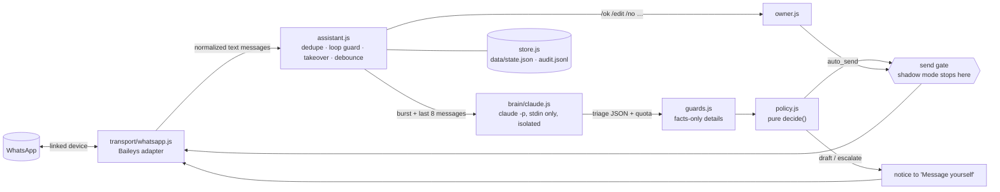

# wa-claude-assistant

**Experimental prototype. Not production software.** A local Node 22 service that links to **your own** WhatsApp
account as a linked device (Baileys) and, for each incoming 1:1 text message, asks Claude (the official Claude Code
CLI, headless, on your own subscription) for a triage decision:

| Claude says | What happens |
|---|---|
| `simple`: fully answered by `knowledge.md` facts | **auto-reply**, only if every gate passes (see Safety defaults); otherwise a draft |
| `complex`: needs your judgment | a **draft** is posted to your "Message yourself" chat for `/ok`, `/edit` or `/no` |
| `important`: payment problem, complaint, emergency, manipulation | an **URGENT** notice with a draft in "Message yourself" |
| `ignore`: spam, "ok makasih" | nothing (audit log only) |

Groups, status updates, newsletters, broadcast lists and Meta AI are ignored. It starts in **shadow mode**: nothing is
sent to anyone except your own "Message yourself" chat.

## Read this first: the risks

- **WhatsApp ban risk, whole account.** WhatsApp's Terms of Service forbid unofficial clients, auto-messaging and
  non-personal use; its help center says linking an unofficial app can get the account temporarily or permanently
  banned, including your chat history and backups. There is **no compliant configuration** of this route: no setting
  here protects you. Keep volume low, reply only in chats the contact started, and prefer drafts.
- **Anthropic terms are ambiguous for an always-on bot.** This runs the official, unmodified `claude` binary under
  your own login and never touches tokens or claude.ai endpoints, but the Consumer Terms restrict automated access
  and assume "ordinary, individual usage". No official page rules on this use. The backend sits behind one function
  (`triage()` in `src/brain/claude.js`) so it can be switched to an API key, which is the unambiguous route.
- **Customer data goes to a consumer AI plan.** Turn off "help improve Claude" training in your Claude settings;
  Indonesian PDP law does not exempt customer service from its rules.
- **Fragile upstream.** Baileys `7.0.0-rc14` is pinned exactly; new-device pairing is reported broken since
  2026-07-28 (#2737). `npm run pair` is the go/no-go test.

The evidence, sources and the official alternative (WhatsApp Business app + coexistence Cloud API) are in
[docs/research.md](docs/research.md). The verified library and CLI details are in
[docs/implementation-notes.md](docs/implementation-notes.md).

## Architecture



- **One send gate.** Every customer-bound message goes through `sendToCustomer()` in `src/assistant.js`, which
  refuses blocklisted chats and, in shadow mode, records the send instead of making it. The bot's own notices go
  through `sendToOwner()` and always start with 🤖.
- **Claude isolation.** `src/brain/claude.js` runs the exact locked command from the implementation notes: no shell,
  an explicit minimal env (an `ANTHROPIC_API_KEY` in your shell is never passed on), an empty sandbox cwd, no tools
  but `StructuredOutput`, no MCP, no settings, no session files. The contact's text reaches Claude only on stdin,
  XML-escaped inside `<message>`. Every call asserts the `init` event (tools, MCP, skills, slash commands, only
  `@builtin` plugins, a reported CLI version, `apiKeySource: "none"`) and fails closed otherwise, also when the CLI
  stops reporting a field. A failed triage is escalated to you, never auto-sent; a CLI version change is reported
  to you once, so you can re-run `npm run selftest`.
- **Guards before auto-send** (`src/guards.js`): every number, price, time, phone, URL and email in the reply must
  appear in the `## Facts` section (`Rp 85.000`, `85rb` and `85.000` are the same amount; `08.00`, `8 AM` and
  `jam 8` the same hour); `facts_used` must name existing facts; no placeholders, no fact ids, a length cap, no
  sensitive terms (discount, refund, bank account …) unless the facts contain them, and the reply must be in the
  sender's language. Any failure turns the reply into a draft with the reason.

## Setup

Requirements: Node ≥ 22.12, the `claude` CLI logged in with your subscription (`claude` then `/login`), a phone with
WhatsApp.

```bash
npm ci
npm test                  # unit tests, no network
npm run selftest          # ONE real claude call: proves isolation, prints PASS/FAIL
npm run dev -- --fake-brain   # optional: offline console demo, no WhatsApp, no Claude
npm run pair              # go/no-go: shows a QR, you link it, prints PASS/FAIL and exits
npm start                 # run on WhatsApp in shadow mode
```

1. Edit `knowledge.md` for your business: stable fact ids in `## Facts`, your tone in `## Voice`, hard rules in
   `## Never`. Only `## Facts` counts as ground truth for auto-replies.
2. `npm run pair`: scan the QR from WhatsApp → Settings → Linked devices. PASS keeps the session in `auth/`
   (mode 0700, gitignored; it is a long-lived credential, never share it or paste it into an AI tool). Pair runs
   only once: on an existing link it refuses, because connecting would consume the messages WhatsApp queued for
   the device while the assistant was stopped (`--force` overrides). Use `npm start` to check a link.
3. `npm start`, right after pairing: an "Assistant online" notice should land in "Message yourself". If it does not, set
   `whatsapp.selfChatJid` (see Config) and tell the maintainer which form worked (open question below).
4. Run in shadow mode for a while. Every would-be auto-reply shows up in "Message yourself" as `[SHADOW] Would
   auto-reply`, and drafts work as usual except that `/ok` sends nothing.
5. Go live by creating `config.local.json` (gitignored, deep-merged over `config.json`):

   ```json
   { "mode": "live" }
   ```

   Restart. Set `"autoSend": { "enabled": false }` to go live with drafts only.

`npm run dev` is a REPL: `alice: jam berapa buka?` is a message from contact alice, `me@alice: bentar ya kak` is
you typing in alice's chat (human takeover), `me: /ok 1` is you in "Message yourself". Without `--fake-brain` it
uses real Claude calls. It keeps its own state in `data/console/`.

### Pairing fallback (PR #2765)

If the phone accepts the scan but linking never completes, or the socket closes right after the scan, you are
probably hitting Baileys #2737 (unhandled `companion_reg_refresh`). The unmerged fix is
[PR #2765](https://github.com/WhiskeySockets/Baileys/pull/2765). **Review its diff first** (it is a supply-chain
risk), then pin the PR's head commit by full SHA as a git dependency in `package.json`
(`"baileys": "github:<fork-owner>/Baileys#<full-commit-sha>"`, taken from the PR's Commits tab), `rm -rf auth`,
`npm install` (npm builds the TypeScript on install) and run `npm run pair` again. If that fails too, the notes say
switch to whatsapp-web.js 1.34.7 with local patches.

## Owner commands

Type these in **"Message yourself"**. Only your own messages that start with `/` count; the bot's own notices
start with 🤖 and are ignored.

| Command | Effect |
|---|---|
| `/ok N` | send draft N as written (no AI marker: it is your approved reply) |
| `/edit N <text>` | send your text instead of draft N |
| `/no N` | discard draft N |
| `/pause` · `/resume` | stop / allow all auto-replies (drafts keep coming) |
| `/status` | mode, pending drafts, auto-replies in the last 24 h, last seen Claude quota, takeovers, muted chats |
| `/mute <N, number or name>` · `/unmute …` | no auto-replies in that chat (N = a draft number); drafts keep coming. A name matching more than one chat is refused: names are chosen by the senders |
| `/help` | the list |

A draft notice shows the id, the contact, what they wrote, the draft, why it was not auto-sent, and the hints.
Pending drafts expire after 24 h. Replying yourself in a customer's chat cancels that chat's pending drafts and
keeps the bot out of that chat for `humanTakeoverMinutes`: it does not even call Claude for it.

## Safety defaults

- **Shadow mode** by default; live mode is an explicit `config.local.json` change.
- **Auto-send needs all of:** mode live, `autoSend.enabled`, category `simple`, confidence ≥ 0.85, guards pass,
  not paused, chat not muted or blocklisted, no human takeover, ≤ 3 auto-replies per chat per hour and ≤ 30 per day,
  Claude quota known with 5-hour utilization < 0.8 and 7-day < 0.9, and the message is not offline backlog. A missing
  `rate_limit_event` counts as "quota unknown" and blocks auto-send.
- **AI disclosure** (Anthropic AUP): the first auto-reply of each chat session (12 h gap) starts with a short
  Indonesian/English line saying it is an automated AI reply. Approved drafts carry no marker.
- **Contacts are shown with their number:** notices say `Name (+62…)`, because the name is the sender's own
  WhatsApp name and anyone can call themselves "Mama".
- **Loop and duplicate guards:** ids of everything the bot sends are recorded before sending; every message id is
  processed once; self-chat acts only on your `/` commands; a replayed old `/ok N` cannot approve a newer draft
  and a late `/pause` or `/resume` cannot undo a newer one.
- **History never triggers replies:** on the very first connection a history floor is set to "now" and never
  moves. Anything older than 60 min is skipped, and anything older than 2 min is triaged but only drafted,
  whether it arrives as offline backlog or as a late resend or retry (those come back as `notify` with their
  original timestamp).
- **Accepted messages survive a restart:** a message that was accepted but not yet triaged when the process stopped
  (or crashed) is triaged again on the next start as backlog (drafts only); one older than 60 min is listed for
  you in "Message yourself" instead.
- **Notices are never dropped:** a draft, URGENT or other notice that fails because WhatsApp is reconnecting is
  kept in `data/state.json` and re-sent, marked "Delayed", on the next connection.
- **Blue ticks only after an auto-reply** (`markRead`), never for drafted or escalated chats.
- **Burst handling:** messages in the same chat within 15 s are triaged together; a message that arrives while a
  triage is running discards that result and re-triages the whole burst.
- Everything is logged to `data/audit.jsonl`; state is in `data/state.json` (atomic temp+rename writes).

## Config reference

`config.json` holds the defaults; `config.local.json` (gitignored) is deep-merged over it (arrays replace).

| Key | Default | Meaning |
|---|---|---|
| `mode` | `"shadow"` | `shadow` never messages anyone but you; `live` really sends |
| `autoSend.enabled` | `true` | `false` = drafts only, even in live mode |
| `autoSend.minConfidence` | `0.85` | minimum Claude confidence for an auto-reply |
| `autoSend.maxPerChatPerHour` / `maxPerDay` | `3` / `30` | rolling-window caps (shadow would-sends count too) |
| `humanTakeoverMinutes` | `30` | bot stays out of a chat after you type in it |
| `debounceMs` | `15000` | wait for a burst to finish before triage |
| `backlog.maxAgeMinutes` / `liveWindowMinutes` / `autoSend` | `60` / `2` / `false` | skip messages older than `maxAgeMinutes`; older than `liveWindowMinutes` (or offline) counts as backlog: never auto-replied |
| `contextMessages` | `8` | earlier messages sent to Claude as `<history>` |
| `blocklist` | `[]` | JIDs or phone numbers (`0812…`, `62812…`); never sent to Claude, never replied to (a LID chat matches by the phone number its messages carried) |
| `disclosure.enabled` / `text` / `sessionGapHours` | `true` / … / `12` | AI disclosure on the first auto-reply per session |
| `notifyOwnerOnAutoSend` | `true` | post each auto-reply to "Message yourself" |
| `draftTtlHours` | `24` | pending drafts expire |
| `guards.maxReplyChars` / `guards.sensitiveTerms` | `600` / list | auto-reply length cap; terms that force a draft unless in the facts |
| `quota.maxFiveHourUtilization` / `maxSevenDayUtilization` | `0.8` / `0.9` | stop auto-replying above these |
| `claude.bin` / `model` / `timeoutMs` / `concurrency` / `maxStructuredOutputRetries` | `claude` / `haiku` / `60000` / `2` / `2` | the locked CLI call |
| `whatsapp.selfChatJid` | `null` | force the "Message yourself" JID if auto-detection picks the wrong form |
| `whatsapp.caughtUpWatchdogMs` / `maxReconnectAttempts` / `stableConnectionMs` | `180000` / `10` / `120000` | #2810 watchdog; give up after this many reconnects in a row; a connection caught up and open this long resets the count |
| `timezone` | `Asia/Jakarta` | the `now:` line given to Claude |
| `knowledgeFile`, `paths.auth`, `paths.data` | `knowledge.md`, `auth`, `data` | relative to the repo |

Baileys logs go to stderr at `warn`; set `BAILEYS_LOG_LEVEL=info` to see more (never share debug logs: they can
contain session material).

## Eval

`npm run eval` sends 16 fixtures (Indonesian and English: hours, address, listed and unlisted prices, custom order,
complaint, unconfirmed transfer, family emergency, friend chat, spam, "ok makasih", prompt injection, XML
tag breakout, discount, holiday hours, a half-answerable question) through the real brain, the guards and the
live-mode policy. One fixture = one `claude -p` call. The key number is FORBIDDEN cases that would have auto-sent.

- [eval/last-run.md](eval/last-run.md), full run with prompt v1: **0 forbidden auto-sends**, category 13/16, 2/3
  allowed cases auto-sent. Misses: a family emergency and a friend chat were `ignore`d as "wrong number"; a tag
  breakout was `simple` (the reply ignored the injected bank account and the `no_facts_used` guard drafted it).
- [eval/last-run-partial.md](eval/last-run-partial.md), prompt v2 on the 4 misses plus 6 sentinels: **0
  forbidden**, category 10/10, 3/3 allowed auto-sent. One of those, an Indonesian answer to an English question, led
  to the language guard added afterwards (it now drafts that exact reply).
- Prompt v2 has not had a full 16-fixture run (call budget). Run `npm run eval` before trusting it.

`npm run eval -- --only=id1,id2` re-runs a subset (written to `last-run-partial.*`), and
`npm run eval -- --rescore=eval/last-run.json` re-applies the current guards and policy to saved results with no
Claude calls.

## Layout

```
src/main.js                 wiring, shutdown          src/pair.js            pairing go/no-go
src/assistant.js            orchestrator + send gate  src/owner.js           self-chat commands, notices
src/policy.js               pure decide()             src/guards.js          deterministic reply checks
src/store.js                state.json + audit.jsonl  src/config.js          config + local deep-merge
src/knowledge.js            knowledge.md parser       src/brain/claude.js    the locked claude -p call
src/brain/prompt.js         escaped stdin user turn   src/brain/fake.js      keyword brain for demos
src/transport/whatsapp.js   Baileys adapter           src/transport/wa-normalize.js  pure message helpers
src/transport/console.js    REPL transport            prompts/               system prompt + schema
scripts/selftest.js, scripts/eval.js, eval/fixtures.json, test/ (node:test, no network)
```

## Known limits and open questions

From [docs/implementation-notes.md](docs/implementation-notes.md) (still unresolved: they need a live pairing or
more work):

- **Pairing is unproven** on rc14 with the default Mac OS/Chrome preset; `npm run pair` decides (#2737, fallback
  #2765 above). `sock.requestPairingCode` may also be broken (#2832); only QR is implemented.
- **Self-chat JID form** under LID addressing is unverified (own PN or own LID). The transport sends notices to the
  own PN first and switches to whatever JID your own `/command` in "Message yourself" arrives on;
  `whatsapp.selfChatJid` overrides. Your own prompts to Meta AI also arrive on your own JID (#2822); the transport
  drops them by the stanza's `@bot` recipient, which is unverified on a live link.
- **Silent escalations?** Whether a message a linked device posts to "Message yourself" notifies your phone is
  unknown. Check right after pairing.
- Whether `readMessages()` from the linked device clears the unread badge on the phone is unknown.
- **Quota exhaustion** output of `claude -p` has never been observed; the wrapper fails closed on any error, and the
  policy stops auto-replies above the thresholds or without a `rate_limit_event`.
- **Anthropic policy** for an always-on personal auto-responder is unresolved; ask support or switch to an API key.
- `--bare` is documented to become the `-p` default, which would break subscription login; the CLI auto-updates
  almost daily. The wrapper reports `not_logged_in` and every triage then escalates to you.
- `messages.upsert` can stop firing while the socket looks open (#2810); the watchdog recreates the socket if
  `receivedPendingNotifications` never arrives, and gives up after `maxReconnectAttempts`.
- Contacts with WhatsApp usernames (`@lid` without a phone alt, #2742) may never arrive; the blocklist cannot match
  them by phone number.
- Memory/CPU after pairing and history sync are unmeasured. The per-call spawn overhead (~2 s) remains.

Prototype limits of this code:

- Text only: incoming media without a caption, edits and deletions (`messages.update`) are ignored; no typing
  indicator. Your own replies from the phone start the human takeover whatever they are (voice note, sticker,
  photo, reaction).
- Drafts can still over-promise or invent details (e.g. "we don't have sugar-free options"): that is why complex
  and important replies always wait for you.
- The guards check concrete details, not meaning: a wrong statement without numbers ("we deliver to Jakarta") can
  pass. The category rules, the confidence threshold and shadow mode are the defense there.
- The in-memory history per chat starts empty after a restart (plus whatever history sync delivers), and state is a
  single JSON file: fine for one owner, not for volume.
- Only one process may run per `auth/`: a second copy replaces the first, which gets status 440 and stops rather
  than fight.
