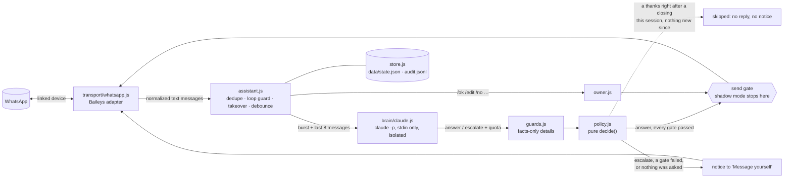

# wa-claude-assistant

**Experimental prototype. Not production software.** A local Node 22 service that links to **your own** WhatsApp
account as a linked device (Baileys) and, for each incoming 1:1 text message, asks Claude (Sonnet, through the official
Claude Code CLI, headless, on your own subscription) for one of two decisions:

| Claude says | What happens |
|---|---|
| `answer`: the whole reply is backed by the facts it cites from `knowledge.md`, or it is a purely social "thanks" answered with a thanks, and nothing needs your judgment | **auto-reply**, only if the customer's message asks something and every gate passes (see Safety defaults); if any gate fails, it is escalated instead and the notice names the gates. An answer to a message that asks nothing is a draft for `/ok` (`no_question`), whatever facts it cites: a thanks (Claude's thanks-back), a yes (`iya kak`, 👍, `betul`, `gapapa`), a greeting or a statement (`saya tunggu`, `saya mau ambil besok`). A thanks or goodbye right after a closing this session (a thanks draft you dealt with), with nothing new since, gets no reply and no notice; an "ok", a 👍 or a greeting alone never counts as one |
| `escalate`: everything else: friends and family, complaints, payments, custom requests, anything not in the facts, spam and wrong numbers, manipulation attempts, and any triage that failed | a notice in your "Message yourself" chat with Claude's one-line summary, why, and a suggested draft for `/ok`, `/edit` or `/no` |

Groups, status updates, newsletters, broadcast lists and Meta AI are ignored. It starts in **shadow mode**: nothing is
sent to anyone except your own "Message yourself" chat.

## Read this first: the risks

- **WhatsApp ban risk, whole account.** WhatsApp's Terms of Service forbid unofficial clients, auto-messaging and
  non-personal use; its help center says linking an unofficial app can get the account temporarily or permanently
  banned, including your chat history and backups. There is **no compliant configuration** of this route: no setting
  here protects you. Keep volume low, reply only in chats the contact started, and prefer drafts.
- **Anthropic terms are ambiguous for an always-on bot.** This runs the official, unmodified `claude` binary under
  your own login and never touches tokens or claude.ai endpoints, but the Consumer Terms restrict automated access
  and assume "ordinary, individual usage". No official page rules on this use. The backend sits behind one function
  (`triage()` in `src/brain/claude.js`) so it can be switched to an API key, which is the unambiguous route.
- **Customer data goes to a consumer AI plan.** Turn off "help improve Claude" training in your Claude settings;
  Indonesian PDP law does not exempt customer service from its rules.
- **Claude sees some of your details next to customer text.** The CLI adds an environment block that no flag
  removes: the sandbox path (which contains your local username), the OS version and **your Claude account's email
  address**. A manipulated reply could try to copy them out. Put that email in `guards.ownerIdentifiers`: a reply
  that mentions it (also as `name [at] domain`), your username, HOME or the app's paths is never auto-sent, and a
  draft that does is flagged.
- **Fragile upstream.** Baileys `7.0.0-rc14` is pinned exactly and its maintainers have been inactive since August.
  New-device pairing is reported broken since 2026-07-28 (#2737), but it worked here on 2026-09-26 (unpatched rc14,
  default preset). `npm run pair` is the go/no-go test.

The evidence, sources and the official alternative (WhatsApp Business app + coexistence Cloud API) are in
[docs/research.md](docs/research.md). The verified library and CLI details are in
[docs/implementation-notes.md](docs/implementation-notes.md).

## Architecture



- **One send gate.** Every customer-bound message goes through `sendToCustomer()` in `src/assistant.js`, which
  refuses blocklisted chats and, when `allowChats` is set, every chat it does not list, and, in shadow mode, records
  the send instead of making it. The bot's own notices go through `sendToOwner()` and always start with 🤖.
- **Claude isolation.** `src/brain/claude.js` runs the exact locked command from the implementation notes: no shell,
  an explicit minimal env (an `ANTHROPIC_API_KEY` in your shell is never passed on), an empty sandbox cwd, no tools
  but `StructuredOutput`, no MCP, no settings, no session files. The contact's text reaches Claude only on stdin,
  XML-escaped inside `<message>`. Every call asserts the `init` event (tools, MCP, skills, slash commands, only
  `@builtin` plugins, a reported CLI version, `apiKeySource: "none"`) and fails closed otherwise, also when the CLI
  stops reporting a field. A failed triage is escalated to you, never auto-sent; a CLI version change is reported
  to you once, so you can re-run `npm run selftest`.
- **Guards before auto-send** (`src/guards.js`): every number, price, time, duration, percentage, phone, URL and
  email in the reply must appear in the facts the reply cites in `facts_used`, as the same kind of detail
  (`Rp 85.000`, `85rb` and `85.000` are the same amount; `08.00`, `8 AM` and `jam 8 pagi` the same hour; `3 hari`,
  `3 pekan` and `3 bln` are durations, `20%` a percentage). Kinds stay apart: the 3 of `3 hari` never licenses a
  bare 3, and a number with any other word (`3 loyang`, `25 Desember`) must appear with that same word. Numbers
  written as words (`seratus ribu`, `sepekan`, `separuh`, `kedua`, `twice`, `a quarter`), digits of other scripts
  and any bare domain fail unless the cited facts have them. `facts_used` must name existing facts and is never
  empty: a reply that cites no fact, a thanks-back included, is never auto-sent (`no_facts_used`). Before any guard
  counts, the policy holds an answer to a message that asks nothing, whatever it cites (`no_question`, see Safety
  defaults). No placeholders, no fact ids, a length cap, no sensitive terms (discount, voucher, gift, refund, bank account …, including affixed forms like
  `diskonnya`, `direfund`) unless the cited facts contain them, and the reply must be in the sender's language. Any failure escalates the
  answer, with the reason in the notice.

## Setup

Requirements: Node ≥ 22.12, the `claude` CLI logged in with your subscription (`claude` then `/login`), a phone with
WhatsApp.

```bash
npm ci
npm test                  # unit tests, no network
npm run selftest          # ONE real claude call: proves isolation, prints PASS/FAIL
npm run dev -- --fake-brain   # optional: offline console demo, no WhatsApp, no Claude
npm run pair              # go/no-go: shows a QR, you link it, prints PASS/FAIL and exits
npm start                 # run on WhatsApp in shadow mode
```

1. Edit `knowledge.md` for your business: stable fact ids in `## Facts`, your tone in `## Voice`, hard rules in
   `## Never`. Only `## Facts` counts as ground truth for auto-replies.
2. `npm run pair`: scan the QR from WhatsApp → Settings → Linked devices. PASS keeps the session in `auth/`
   (mode 0700, gitignored; it is a long-lived credential, never share it or paste it into an AI tool). Pair runs
   only once: on an existing link it refuses, because connecting would consume the messages WhatsApp queued for
   the device while the assistant was stopped (`--force` overrides). Use `npm start` to check a link.
3. `npm start`, right after pairing: an "Assistant online" notice should land in "Message yourself". If it does not, set
   `whatsapp.selfChatJid` (see Config) and tell the maintainer which form worked (open question below).
4. Run in shadow mode for a while. Every would-be auto-reply shows up in "Message yourself" as `[SHADOW] Would
   auto-reply`, and drafts work as usual except that `/ok` sends nothing.
5. Go live by creating `config.local.json` (gitignored, deep-merged over `config.json`):

   ```json
   { "mode": "live" }
   ```

   Restart. Set `"autoSend": { "enabled": false }` to go live with drafts only.

`npm run dev` is a REPL: `alice: jam berapa buka?` is a message from contact alice, `me@alice: bentar ya kak` is
you typing in alice's chat (human takeover), `me: /ok 1` is you in "Message yourself". Without `--fake-brain` it
uses real Claude calls. It keeps its own state in `data/console/`.

### Testing with one contact

To try live mode on your personal WhatsApp with one friend who knows it is a bot test, list only that chat in
`config.local.json`:

```json
{ "mode": "live", "allowChats": ["081293850000"] }
```

Entries are phone numbers (`0812…`, `62812…`, `+62 812-…`, `+62 0812-…`) or JIDs, matched like `blocklist` entries
on both of the contact's addressing forms (PN and LID). Restart: the startup line and the "Assistant online" notice
say `only 1 listed chat is handled`, and `/status` shows the list. What you will see:

- Drafts, auto-replies and their notices, and human takeovers for that chat only. "Message yourself" works as
  always.
- Every other chat is ignored before anything happens to it: no Claude call, no draft or notice, no blue ticks, no
  takeover when you reply there yourself, nothing written to `data/state.json`. `data/audit.jsonl` gets one
  `skip_not_allowed` line per message with the chat's JID only, never the text. Those messages are not picked up
  later either, when you remove the list.
- If your friend's chat arrives as a LID (`…@lid`) whose phone number neither the message nor WhatsApp's LID mapping
  gives, it cannot match a phone number, so it is ignored too: find its `skip_not_allowed` line and add that `…@lid`
  JID to the list. Your own reply on such a LID is remembered in memory only (its time, no text, lost on a restart):
  once a message of your friend links that LID to the listed number, your reply starts the human takeover as usual,
  so the bot does not answer on top of you.
- A draft of another chat still pending from before cannot be sent: `/ok` and `/edit` answer `chat is not in
  allowChats` and the draft stays pending (`/no` discards it). Messages of other chats that were waiting in the
  inbox before a restart are dropped, not triaged.

Remove the key (or set `"allowChats": []`) and restart to handle every chat again. `npm run dev` reads
`config.local.json` too; its contacts are `alice@console` and so on, so list those there or remove the key.

### Pairing fallback (PR #2765)

Pairing passed on unpatched rc14 on 2026-09-26, so this is only for a future re-pair that fails. If the phone
accepts the scan but linking never completes, or the socket closes right after the scan, you are probably hitting
Baileys #2737 (unhandled `companion_reg_refresh`). The unmerged fix is
[PR #2765](https://github.com/WhiskeySockets/Baileys/pull/2765). Its diff was reviewed on 2026-09-26 (safe to pin;
details in the implementation notes); re-check that the head is unchanged, then pin it by full SHA in `package.json`
(`"baileys": "github:WhiskeySockets/Baileys#4f263f0e365c2e74dd1b824031d1c5910f518c26"`), `rm -rf auth`,
`npm install` (npm builds the TypeScript on install) and run `npm run pair` again. If that fails too, the notes say
switch to whatsapp-web.js 1.34.7 with local patches.

## Owner commands

Type these in **"Message yourself"**. Only your own messages that start with `/` count; the bot's own notices
start with 🤖 and are ignored, and so is anything you forward there (a customer's message that starts with
`/edit 7 …` is not your command).

| Command | Effect |
|---|---|
| `/ok N` | send draft N as written (no AI marker: it is your approved reply) |
| `/edit N <text>` | send your text instead of draft N |
| `/no N` | discard draft N |
| `/pause` · `/resume` | stop / allow all auto-replies (drafts keep coming) |
| `/status` | mode, pending drafts, auto-replies in the last 24 h, last seen Claude quota, takeovers, muted chats |
| `/mute <N, number or name>` · `/unmute …` | no auto-replies in that chat, on both its addressing forms (N = a draft number); drafts keep coming. A name matching more than one contact is refused: names are chosen by the senders |
| `/help` | the list |

Every escalation uses one notice format: `📝 DRAFT #N · contact`, what they wrote, Claude's one-line summary, the
suggested draft, Claude's reason, the gates that held back an answer (`Not auto-sent: …`, e.g. `guard:unsupported_amount:150000`
or `triage_failed:timeout`), and the hints. There is no separate "urgent" format: the summary and reason say what it
is about (a family emergency reads as one).
Pending drafts expire after 24 h. Replying yourself in a customer's chat cancels that chat's pending drafts and
keeps the bot out of that chat for `humanTakeoverMinutes`: it does not even call Claude for it. This covers both
addressing forms of the chat (phone number and LID), which WhatsApp can mix within one conversation, and so do
`/mute`, a recorded closing and the 3 auto-replies per hour. A reply of yours that the assistant only sees
late (it was down, or the reply is older than `humanTakeoverMinutes`) starts no takeover, but it still counts as the
answer to everything the customer wrote before it: those messages are not triaged, and drafts made from them are
cancelled.

## Safety defaults

- **Shadow mode** by default; live mode is an explicit `config.local.json` change.
- **Auto-send needs all of:** mode live, `autoSend.enabled`, decision `answer`, the message asks something, guards pass, not paused, chat not muted or blocklisted, no human takeover, ≤ 3 auto-replies per chat per hour and ≤ 30 per day,
  Claude quota known with 5-hour utilization < 0.8 and 7-day < 0.9, the message is not offline backlog, and it
  carries no attachment. A missing `rate_limit_event` counts as "quota unknown" and blocks auto-send.
- **Attachments are never auto-answered:** Claude sees a photo's, video's or document's caption and is told a file
  is attached, but never the file, so a `makasih kak 🙏` on a transfer screenshot is a draft
  (`no_question, attachment:image`), gets no blue ticks, and the notice shows `[image] makasih kak 🙏`. A
  photo without a caption, a voice note, a location pin, a contact card, a message that could not be decrypted or
  other content without text is not triaged, but it stays in the chat history (Claude sees it as
  `attachment="location"` and so on) and its time is kept in `data/state.json`, so a thanks after it is never skipped:
  also when it came while a thanks draft waited and your `/ok` sent the closing after it, when it came on the other
  addressing form, and after a restart. A sticker, a reaction (a 👍 on our offer may be a yes), an edit or a call
  from the customer (one that rang out, or one they ended first) stays out of the history, but its time is kept the
  same way.
- **Only an answer to a message that asks something is auto-sent** (owner decision, 2026-09-27; a thanks since
  2026-09-26). Whatever Claude decides and whatever facts it cites, an answer to a message that asks nothing (a
  thanks, a yes, a no, a greeting, a statement) is a draft whose notice leads with `no_question`, so Claude's thanks-back
  (`Sama-sama, Kak 🙏`) waits for your `/ok`, and so does a fact-backed promise to an `iya kak` that may agree to
  something your side offered. A thanks is skipped, with no reply and no notice (audited as action
  `skip`, `closing_already_sent`), only right after a closing this session with nothing new since. A closing is a
  thanks draft you dealt with by `/ok`, `/edit` or `/no` (in shadow mode too), dated by that thanks. After a `/no`, a
  shadow `/ok` or a restart, only a plain thanks (`makasih kak 🙏`, `makasih ya kak`) is skipped: one with an
  acknowledgement, a 👍 or a `ya` before the thanks (`iya kak makasih`, `👍 makasih`, `ya kak, makasih`) may be the
  yes to our last message before the thanks, which nothing answered, and is drafted. The message your `/ok` or `/edit` sent is recognised by its message id (kept in `data/state.json`, on
  both addressing forms), and only when it is itself just a thanks-back: one that asks or offers anything
  (`Sama-sama kak! Mau sekalian pesan untuk Sabtu?`) is new, so an `iya kak, makasih 🙏` after it is drafted. Any
  other message from our side after that thanks (on either addressing form, and from before a restart: the time of
  our last word is kept in `data/state.json`, never older than the newest customer message already received, so a
  local clock behind WhatsApp's cannot date a reply before the thanks it followed), anything but a thanks from the
  customer since that thanks (an `iya`, a question, a photo, a location pin, a message that could not be decrypted, a
  sticker, a reaction, an edit; on either addressing form and from before a restart too, since its time is kept in
  `data/state.json`), a thanks with a file or one that quotes
  any message but the thanks-back your `/ok` or `/edit` sent (our question before a thanks you discarded, or a photo,
  voice note or pin of ours, which has no text: quotes are matched by message id), a closing from an earlier session
  (`disclosure.sessionGapHours`) and a failed triage are never skipped. Every other thanks is a
  draft, also while another draft of that chat is open. In shadow mode the bot's answers never reach the chat, so a
  thanks after a shadow auto-reply meets the customer's question still unanswered in the history and is drafted
  where live mode would skip it.
- **What counts as a thanks** for the skip is matched narrowly (`isThanks` in `src/guards.js`), since a missed
  thanks only costs a draft while a false match could drop a real message: a thanks or goodbye phrase (`makasih`,
  `terima kasih`, `thanks`, `sama-sama`, `bye`, `take care`, `have a nice day` …) with at most acknowledgements (`ok`, `siap`, `iya`), honorifics, softeners (`ya`, `banyak`,
  `so much`) and friendly or agreeing emoji around it, or friendly emoji alone (`🙏`, `😊`, `❤️`); at most 16 words
  and emoji, no `?`, no digits, no other symbol (`😡`, `ok :(`, `-_-` and `!!!` are no thanks, and neither are
  `no good` or `oh no`, whose words only count inside a phrase). An acknowledgement or 👍 alone can be a yes to
  something our side asked, a greeting opens a conversation (also next to a thanks: `makasih kak, selamat siang`),
  and phrases that can agree to, arrange or ask for something (`no problem`, `anytime`, `see you`, `sampai jumpa`,
  `hati-hati`, `lagi`, `dong`) are not in that vocabulary: after a closing they are drafted, not skipped.
- **What counts as asking** is matched the other way round (`asksSomething`): no list knows every way to thank or
  agree (`makasih bang`, `sama2`, `betul`), so it lists what asks, and a missed question only costs a draft. A
  message asks something if it has a `?` (fullwidth too), a question word (`apa`, `berapa`, `kapan`, `dimana`,
  `mana`, `gimana`, `kenapa`, `siapa`, `bisakah` and the other `-kah` questions; `what`, `when`,
  `where`, `which`, `who`, `why`, `how`, `does` …), `tanya` as a request to ask (`mau tanya`, `boleh nanya`,
  `numpang tanya`, `tanya dong kak`; not `maaf banyak tanya`, `maaf nanya terus` or `nanti saya tanya lagi`), an
  English question opening at the start of a clause (`do you`,
  `is there`, `is it`, `are you`, `will you`, `may i`, `tell me`, `let me know`; inside one it states: `thank you,
  that is it`), `would like` with something to want (`I would like the address`, not `I would like that` or `would
  like to thank you`), `info` as a request (`info harga`, not `makasih infonya`, `thanks for the info`, `nanti saya
  info lagi` or `info diterima`), a request word with something to request in its clause (`bisa kirim ke Bekasi`,
  `boleh minta alamatnya`, `tolong kirim besok`, `please send the menu`; `can`, `could` and `would` only before
  their subject: `can you deliver`, `could I pay by transfer`; `ada` only where it opens its clause: `ada brownies
  kak`, `kak, masih ada stok coklat`, not `kalau ada apa-apa saya hubungi lagi`, `besok ada yang ambil` or `ada
  teman yang ambil`), or a tag question at the end of a clause (`tokonya
  buka gak kak`, `ready ga`, `sudah sampai belum`, `buka minggu kan`). A request word alone or with only an
  intensifier or a go-ahead says yes (`bisa kak`, `boleh banget kak`, `bisa bgt`, `tentu bisa`, `masih ada kak`,
  `yaudah boleh kak`, `boleh kak lanjut`, `tolong ya`,
  `yes please`, `please go ahead`, `that would be great`, `sure you can`), after a negation it says no (`gak ada
  kak, makasih`, `gak bisa kak`, `belum ada`), and after `saya` or `I` it states (`saya bisa ambil besok`).
  Reduplicated question words ask nothing (`nggak apa-apa`, `kapan-kapan`), and neither do `apa`, `napa`, `knp`,
  `kenapa`, `mengapa` or `ngapain` after a negation ("no problem" however it is spelled: `gak apa kak`, `ga napa`,
  `tidak mengapa`), a question word after the customer's own "I'll tell you" or "I think" (`nanti saya kabari
  kapan ambilnya`, `saya pikir-pikir dulu mau yang mana`, `I'll let you know when I'm there`, `I know where it
  is`, `I will pay when I pick up`) or after `terserah`, a relative (`that's what I needed`, `thanks for what you
  did`, `the one who will pick it up`, `see you when I see you`), an exclamation (`how lovely`, `what a lovely
  cake`, `why not`), "maybe" (`siapa tau nanti order lagi`), "whatever you think" (`gimana kakak aja`, `gimana
  baiknya aja`) or "anything is fine" (`apa aja boleh`, `kapan aja bisa`). `kok`
  is a particle (`bisa kok kak`), not a question word. A shared link is left out, so the `?` of its query string
  (`https://maps.app.goo.gl/…?g_st=iw`) or a word in its path asks nothing; a bare `kak.kirim` is no link. A burst asks
  if any of its messages does, and a question with a thanks (`makasih kak, jam berapa tutup?`) goes on to the other
  gates like any question.
- **AI disclosure** (Anthropic AUP): the first auto-reply of each chat session (12 h gap) starts with a short
  Indonesian/English line saying it is an automated AI reply. Approved drafts carry no marker.
- **Contacts are shown with their number:** notices say `Name (+62…)`, because the name is the sender's own
  WhatsApp name and anyone can call themselves "Mama".
- **Loop and duplicate guards:** ids of everything the bot sends are recorded before sending; every message id is
  processed once; self-chat acts only on your `/` commands; a replayed old `/ok N` cannot approve a newer draft
  and a late `/pause` or `/resume` cannot undo a newer one.
- **History never triggers replies:** on the very first connection (the successful `npm run pair`, which also
  covers messages that arrive before your first `npm start`) a history floor is set to "now" and never
  moves. Anything older than 60 min is skipped, and anything older than 2 min is triaged but only drafted,
  whether it arrives as offline backlog or as a late resend or retry (those come back as `notify` with their
  original timestamp).
- **Accepted messages survive a restart:** a message that was accepted but not yet triaged when the process stopped
  (or crashed), or that arrived while it was shutting down, is triaged on the next start as backlog (drafts only);
  one older than 60 min is listed for you in "Message yourself" instead. A `/command` typed during the shutdown is
  not run (audited only): send it again once the assistant is back. A message whose routing fails after triage (a
  bug in the checks) becomes a draft (`route_failed`), never a silent drop.
- **Notices are never dropped:** a draft or other notice that fails because WhatsApp is reconnecting is
  kept in `data/state.json` and re-sent, marked "Delayed", on the next connection.
- **Blue ticks only after an auto-reply** (`markRead`), never for escalated or skipped messages, and not while the chat still has
  a draft waiting for you (an auto-answered "jam berapa tutup?" does not mark read a chat
  whose "saya sudah transfer" is still unanswered).
- **Pending drafts from the four-category version** (before the answer/escalate switch) stay in `data/state.json` and
  still work with `/ok`, `/edit`, `/no` and `/status`.
- **Burst handling:** messages in the same chat within 15 s are triaged together; a message that arrives while a
  triage is running discards that result and re-triages the whole burst.
- Everything is logged to `data/audit.jsonl`; state is in `data/state.json` (atomic temp+rename writes).

## Model and latency

The brain runs Sonnet (`claude.model: "sonnet"`, `claude-sonnet-5` on 2026-09-26) with thinking off
(`MAX_THINKING_TOKENS=0`). Each triage is one `claude -p` process: the last eval measured avg 5.7 s from spawn to
exit, all 20 calls between 4.6 and 8.5 s (concurrency 2; about 2 s of each call is CLI start-up). Earlier runs saw
avg 7.7 s with one call at 39.5 s (38.0 s of it API time in a single turn, not a retry) and avg 7.0 s with a max of
19.6 s, and research had seen about 11 s on a loaded machine, against 4.5–7.8 s for Haiku. An auto-reply therefore usually lands
about 20–25 s after the customer's last message (the 15 s debounce, then the triage), now and then close to a
minute. `timeoutMs` is 90 s, over twice the slowest call seen, so a structured-output retry still has room; a triage
that times out is escalated to you. With
`concurrency: 2`, a third chat waits for a free slot. Thinking on (`maxThinkingTokens: null`) measured 10–14 s in
research and uses more of your subscription quota. Re-run `npm run eval` after changing the model or thinking.

## Config reference

`config.json` holds the defaults; `config.local.json` (gitignored) is deep-merged over it (arrays replace). A key that
was removed stops the start instead of being ignored: `autoSend.minConfidence` (the confidence gate is gone since the
answer/escalate switch; delete the key).

| Key | Default | Meaning |
|---|---|---|
| `mode` | `"shadow"` | `shadow` never messages anyone but you; `live` really sends |
| `autoSend.enabled` | `true` | `false` = drafts only, even in live mode |
| `autoSend.maxPerChatPerHour` / `maxPerDay` | `3` / `30` | rolling-window caps (shadow would-sends count too) |
| `humanTakeoverMinutes` | `30` | bot stays out of a chat after you type in it |
| `debounceMs` | `15000` | wait for a burst to finish before triage |
| `backlog.maxAgeMinutes` / `liveWindowMinutes` / `autoSend` | `60` / `2` / `false` | skip messages older than `maxAgeMinutes`; older than `liveWindowMinutes` (or offline) counts as backlog: never auto-replied |
| `contextMessages` | `8` | earlier messages sent to Claude as `<history>` |
| `blocklist` | `[]` | JIDs or phone numbers (`0812…`, `62812…`, `+62 812…`, `+62 0812…`); never sent to Claude, never replied to. A LID chat matches a phone number through the number its messages carried or WhatsApp's LID mapping; while its number is unknown and the list has phone numbers, that chat gets drafts only (its messages still reach Claude) and every draft of it, a thanks or an escalation too, shows the LID to add here. Anything but a list of phone numbers or JIDs as WhatsApp writes them (`6281…@s.whatsapp.net`, `…@lid`; not `0812…@s.whatsapp.net`, `620812…@s.whatsapp.net`, `…@c.us` or a `:device` suffix) stops the start |
| `allowChats` | `[]` | empty = every chat. Otherwise only the chats it lists (JIDs or phone numbers, matched like `blocklist`) are handled; every other chat is ignored before anything happens to it (no Claude call, no draft, notice, blue ticks or takeover, nothing in `data/state.json`, one `skip_not_allowed` audit line without the text), and the send gate refuses it. A LID chat whose number is unknown is ignored until you list its LID or its number becomes known; your own reply there is kept in memory and becomes a takeover if the LID turns out to be a listed chat. "Message yourself" always works. Anything but a list of phone numbers or JIDs as WhatsApp writes them (`6281…@s.whatsapp.net`, `…@lid`; not `0812…@s.whatsapp.net`, `620812…@s.whatsapp.net`, `…@c.us` or a `:device` suffix) stops the start. See "Testing with one contact" |
| `disclosure.enabled` / `text` / `sessionGapHours` | `true` / … / `12` | AI disclosure on the first auto-reply per session |
| `notifyOwnerOnAutoSend` | `true` | post each auto-reply to "Message yourself" |
| `draftTtlHours` | `24` | pending drafts expire |
| `guards.maxReplyChars` / `guards.sensitiveTerms` | `600` / list | auto-reply length cap; terms that force a draft unless in the facts |
| `guards.ownerIdentifiers` | `[]` | your details that must never reach a customer, e.g. your Claude account email; with your local username, HOME and the app's paths they force a draft (and a warning on drafts) |
| `quota.maxFiveHourUtilization` / `maxSevenDayUtilization` | `0.8` / `0.9` | stop auto-replying above these |
| `claude.model` | `sonnet` | CLI model alias; it floats, and the eval report shows the model id it resolved to |
| `claude.maxThinkingTokens` | `0` | `0` = thinking off; `null` = the CLI's default (adaptive thinking on Sonnet 5: slower, more quota); a positive number is passed on as `MAX_THINKING_TOKENS` but is untested on Sonnet 5, whose API has no fixed thinking budget |
| `claude.bin` / `timeoutMs` / `concurrency` / `maxStructuredOutputRetries` | `claude` / `90000` / `2` / `2` | the locked CLI call; the timeout is per call, spawn to exit |
| `whatsapp.selfChatJid` | `null` | force the "Message yourself" JID if auto-detection picks the wrong form; it must be your own PN or LID, anything else is refused |
| `whatsapp.caughtUpWatchdogMs` / `maxReconnectAttempts` / `stableConnectionMs` | `180000` / `10` / `120000` | #2810 watchdog; give up after this many connections in a row that open and drop again before staying caught up and open for `stableConnectionMs`. A network outage (no connection opens at all) is retried every ≤ 60 s for as long as it lasts, and an outage of 5 min or more is reported in "Message yourself" once the connection is back |
| `timezone` | `Asia/Jakarta` | the `now:` line given to Claude |
| `knowledgeFile`, `paths.auth`, `paths.data` | `knowledge.md`, `auth`, `data` | relative to the repo |

Baileys logs go to stderr at `warn`; set `BAILEYS_LOG_LEVEL=info` to see more (never share debug logs: they can
contain session material).

## Eval

`npm run eval` sends 20 fixtures (Indonesian and English: hours, address, listed and unlisted prices, custom order,
complaint, unconfirmed transfer, family emergency, friend chat, spam, "ok makasih", prompt injection, XML
tag breakout, discount, holiday hours, a half-answerable question, and four on the social path: a `Selamat pagi kak`
the day after our own closing, a thanks while a delivery request is unanswered, a thanks from "Mama", and `😡😡`)
through the real brain, the guards and the live-mode policy, with each fixture's history (its ages, which of our
messages was sent as a closing, and when that closing's thanks arrived). One fixture = one `claude -p` call. Each
fixture expects `answer` or `escalate` and marks auto-send as allowed (3: hours, address, listed price) or forbidden
(the other 17). The social "ok makasih" still expects `answer`, since the prompt asks Claude for a thanks-back, but
its auto-send is forbidden: it asks nothing, so the policy drafts it. The key numbers are FORBIDDEN cases that would have auto-sent and escalations the policy skipped
(a skip reaches nobody, so an `escalate` fixture may only be skipped if it sets `skipOk`); both must be 0.

- [eval/last-run.md](eval/last-run.md) is a **rescore** (2026-09-27, no Claude calls) of the full run below with
  the current guards and policy, after the change that auto-sends only an answer to a message that asks something
  (it replaced the social matchers and the thanks-back reply check of the review rounds before; untriaged content and
  quotes are never skipped over, and a thanks that agrees is skipped only after our closing reply), re-run after its
  review fixes (`kok` a particle, "no problem" spellings, links, a `ya` before a thanks, stickers and reactions; round
  2: a no, an emphatic or English yes, English openings only at the start of a clause, the customer's own plans;
  round 3: `tanya` only as a request to ask, `siapa tau`, `gimana kakak aja`, `yaudah`/`lanjut` as yes words, `ada`
  only opening its clause, `what a …`, English relatives and plans):
  **0 forbidden auto-sends**, **0 skipped escalations**, decision **20/20**, **3/3 allowed cases auto-sent**.
  Sonnet's `Sama-sama, Kak 🙏` to "ok makasih kak 🙏" is a draft (`no_question`; the guards add `no_facts_used`).
- The full run on `claude-sonnet-5` with thinking off (2026-09-26, 20 calls), after the closing rules were tightened
  (phrases instead of single words, no greeting alone, facts never on a thanks, time-bounded and draft-aware skips,
  quotes and non-file content in the user turn): **0 forbidden auto-sends**, **0 skipped escalations**, decision
  **20/20**, **4/4 allowed cases auto-sent** under the rules of the time ("ok makasih kak 🙏" got "Sama-sama, Kak 🙏"
  through the social check, which is gone), no triage errors. Sonnet escalated `Selamat pagi kak` after yesterday's closing and the
  policy let the escalation stand. The unanswered-request thanks, the "Mama" thanks and `😡😡` were all escalated.
  Latency: avg 5.7 s, max 8.5 s. Raw results are in `eval/last-run.json` for `--rescore`.
- The run before, with a 🙏 after our own closing in place of the greeting fixture (the policy skips that one
  whatever Claude decides, which the unit tests cover): 0 forbidden, decision 19/20 (Sonnet escalated the 🙏), 4/4
  allowed, avg 7.7 s, max 39.5 s. The one before, 16 fixtures: decision 16/16, 0 forbidden, 4/4 allowed.
- Earlier, on Haiku with four categories and a confidence (in git history before the switch, e.g. `f8f9159`):
  category 16/16 with 0 forbidden auto-sends but 2/3 allowed auto-sends, because Haiku answered the English address
  question in Indonesian. [eval/last-run-partial.md](eval/last-run-partial.md) is a 10-fixture subset from that era.
- 20 fixtures are a smoke test, not a guarantee; re-run `npm run eval` after editing the prompt, knowledge, model or
  thinking setting.

`npm run eval -- --only=id1,id2` re-runs a subset (written to `last-run-partial.*`), and
`npm run eval -- --rescore=eval/last-run.json` re-applies the current guards and policy to saved results with no
Claude calls.

## Layout

```
src/main.js                 wiring, shutdown          src/pair.js            pairing go/no-go
src/assistant.js            orchestrator + send gate  src/owner.js           self-chat commands, notices
src/policy.js               pure decide()             src/guards.js          deterministic reply checks
src/store.js                state.json + audit.jsonl  src/config.js          config + local deep-merge
src/knowledge.js            knowledge.md parser       src/brain/claude.js    the locked claude -p call
src/brain/prompt.js         escaped stdin user turn   src/brain/fake.js      keyword brain for demos
src/transport/whatsapp.js   Baileys adapter           src/transport/wa-normalize.js  pure message helpers
src/transport/console.js    REPL transport            prompts/               system prompt + schema
src/chat-lists.js           blocklist, allowChats
scripts/selftest.js, scripts/eval.js, eval/fixtures.json, test/ (node:test, no network)
```

## Known limits and open questions

From [docs/implementation-notes.md](docs/implementation-notes.md) (still unresolved: they need a live pairing or
more work):

- **Pairing** passed once on rc14 with the default Mac OS/Chrome preset (2026-09-26) despite #2737; a re-pair may
  still hit it (fallback #2765 above). `sock.requestPairingCode` may also be broken (#2832); only QR is implemented.
- **Self-chat JID form** under LID addressing is unverified (own PN or own LID). The transport sends notices to the
  own PN first and switches to whatever JID your own `/command` in "Message yourself" arrives on;
  `whatsapp.selfChatJid` overrides. Self-chat is decided by the chat JID alone (never by its alt, which on your
  replies to a customer can be your own number), and notices are refused unless the target is one of your own JIDs. Your own prompts to Meta AI also arrive on your own JID (#2822); the transport
  drops them by the stanza's `@bot` recipient, which is unverified on a live link.
- **Silent escalations?** Whether a message a linked device posts to "Message yourself" notifies your phone is
  unknown. Check right after pairing.
- Whether `readMessages()` from the linked device clears the unread badge on the phone is unknown.
- **Quota exhaustion** output of `claude -p` has never been observed; the wrapper fails closed on any error, and the
  policy stops auto-replies above the thresholds or without a `rate_limit_event`.
- **Anthropic policy** for an always-on personal auto-responder is unresolved; ask support or switch to an API key.
- `--bare` is documented to become the `-p` default, which would break subscription login; the CLI auto-updates
  almost daily. The wrapper reports `not_logged_in` and every triage then escalates to you.
- `messages.upsert` can stop firing while the socket looks open (#2810); the watchdog recreates the socket if
  `receivedPendingNotifications` never arrives, and gives up after `maxReconnectAttempts` such open-then-drop
  cycles in a row. There is no process supervisor: after a give-up (or a 401/403/405/440 stop) restart it by hand.
- Contacts with WhatsApp usernames (`@lid` without a phone alt, #2742) may never arrive. If they do and Baileys'
  local LID mapping does not know their number either, a phone-number blocklist entry cannot match them: such
  chats are drafted, never auto-replied, while the blocklist has phone numbers, and you can block them by LID.
- Memory/CPU after pairing and history sync are unmeasured. The per-call spawn overhead (~2 s) remains.

Prototype limits of this code:

- Text only: incoming media without a caption, location pins, contact cards and the like are not triaged (they only
  show in the history Claude gets, as an attachment it cannot see), captioned
  media is triaged on its caption and never auto-answered, edits and deletions are not triaged (an edit, like a
  sticker or a reaction, only keeps a thanks after it from being skipped); no
  typing indicator. A question sent right after a photo without a caption (`yang kayak gini harganya berapa?`) is
  triaged on its own: Claude sees the photo as an attachment in the history and is told to escalate, but no
  deterministic gate holds its answer (open owner question: hold any answer while the customer's newest file is
  unanswered). Your own replies from the phone start the human takeover whatever they are (voice note, sticker,
  photo, reaction).
- Drafts can still over-promise or invent details (e.g. "we don't have sugar-free options"): that is why escalations
  always wait for you.
- Whether a message asks something is read from its words, not its meaning: a statement with a question or request
  word in it (`saya mau tanya suami dulu`, `ada acara kantor besok`) or a `?` goes on to the other gates like a
  question, and a question without any of them (`harga brownies kak`, `besok ada brownies kak`) is only a draft.
- The guards check concrete details, not meaning: a wrong statement without numbers ("we deliver to Jakarta") can
  pass, and so can a detail moved to the wrong item inside one cited fact ("brownies keep 1 month" citing F12,
  where 1 month is the cookies'). The prompt's rule to answer only what the facts fully cover, the rule that every
  auto-reply cites facts (a reply without facts, a thanks-back included, is always a draft), and shadow mode are the
  defense there. There is no self-reported confidence score (owner decision).
- The in-memory history per chat starts empty after a restart (plus whatever history sync delivers), so right after
  one a plain thanks is skipped whenever a closing was recorded this session, even if the customer wrote something
  else before the restart (an unanswered question: it was triaged on its own, so you have its draft) that the history no
  longer shows. The same holds for a question on the contact's other addressing form. Words of ours and content that
  is never triaged are not lost that way: which of our messages were sent as closings, when our side last wrote, and
  when the customer last sent a file, pin or undecryptable message are kept in `data/state.json`. State is a single
  JSON file: fine for one owner, not for volume.
- Only one process may run per `auth/`: a second copy replaces the first, which gets status 440 and stops rather
  than fight.
