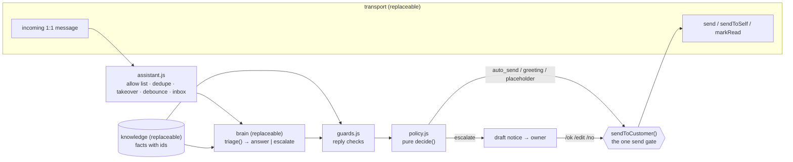

# Building on wa-claude-assistant

How to start another project (or brief an AI agent) from this prototype: which parts to keep, which to replace, and
how to feed it real data. The *why* behind every rule is in [reference-guide.md](reference-guide.md); this page is the
*how*.

## Read in this order

1. This page: the seams and the recipe.
2. [reference-guide.md](reference-guide.md): verified facts, the design and why, what reviews and the live test found.
3. [README.md](../README.md): behavior, owner commands, config reference.
4. [CLAUDE.md](../CLAUDE.md): invariants and owner decisions for this prototype (the invariants carry over; the
   decisions are this owner's and may differ for you).
5. [implementation-notes.md](implementation-notes.md): verified Baileys and `claude -p` details.

Pin the version you build on: tag `v0.1.0` (2026-09-28) is the state these docs describe.

## What it is, in one picture

Status: prototype. 386 unit tests (no network), an eval of 24 fixtures against real Claude, two days live on a
personal WhatsApp account with two testers. Not reviewed by a human.

## The seams

| Layer | Here | Contract | Replace it when |
|---|---|---|---|
| **Transport** | `src/transport/whatsapp.js` (Baileys linked device), `src/transport/cloud-api.js` (official Cloud API since 2026-09-28: signed webhook in, Graph API out, the owner's own number as the owner channel; `"transport": "cloud-api"`), `src/transport/console.js` (REPL) | `createXTransport({config, store, onMessage, onUntriaged?, onReady?, onConnected?, onFatal?})` returning `{name, start(), stop(), send(chatId, text, {quotedRaw?, messageId?}) → {id}, sendToSelf(text, opts), markRead(messages), getHistory(chatId, limit) → [{id, fromMe, text, attachment?, timestamp}], generateId()}`. `onMessage` gets `{id, chatId, chatIdAlt?, fromMe, isSelfChat, isForwarded, senderName, text, attachment?, quotedText?, quotedId?, timestamp (s), kind: 'notify' \| 'append', raw}` | You use the official **WhatsApp Cloud API** (webhook in, Graph API out), another chat channel, or a web widget. The owner channel (`sendToSelf` + owner `/commands`) must move too: the Cloud API has no "Message yourself" |
| **Brain** | `src/brain/claude.js` (`createClaudeBrain`), `src/brain/prompt.js`, `prompts/` | `triage({chat: {name}, history, messages}) → {ok, triage: {decision, reply, facts_used, reason, summary, customer_waiting}, rateLimit?, error?, meta}`; never throws for a model failure (`ok: false` escalates) | You use an **API key** (Anthropic SDK with the same schema as a tool or structured output). Then drop the CLI-only parts (`checkInit`, the `apiKeySource: "none"` assertion) and change the quota gate (`quotaBlockers` in `src/policy.js` needs a `rateLimit`; an API has none of the subscription windows) |
| **Knowledge** | `knowledge.md` → `src/knowledge.js` (`parseKnowledge`) | `{promptText, factsText, facts: Map<'F1', text>}`. `promptText` goes into the system prompt (`{{KNOWLEDGE}}`); `facts` is the only ground truth the guards accept | Your facts live in a database. See "Real data" below |
| **Policy** | `src/policy.js` (`decide`, pure) | `decide(result, ctx) → {action: 'auto_send' \| 'escalate' \| 'skip', reasons, greeting?, placeholder, placeholderWithheld}` | Keep it. Change thresholds in config, not code |
| **Guards** | `src/guards.js` (`checkReply`, `asksSomething`, `isGreetingOnly`, `isThanks`) | `checkReply({reply, factsUsed, incomingText}, {knowledge, …}) → {ok, reasons}` | Keep the facts-only detail checks. Retune the word lists for your language and domain (`sensitiveTerms` in config; question, greeting and thanks words in code) |
| **Owner loop** | `src/owner.js`, notices in `src/assistant.js` | Drafts with numbers, `/ok N`, `/edit N`, `/no N`, `/pause`, `/status`, `/mute` | Keep the model (every escalation is a draft someone approves); move the channel with the transport |
| **Store** | `src/store.js` | One JSON file (`data/state.json`, atomic writes) plus `data/audit.jsonl` | More than one owner or real volume: SQLite or your database |

## Recipe: a new project from this one

1. **New repo from tag `v0.1.0`** (keep the history, or squash it and link back). Don't build it inside an unrelated
   monorepo branch: the bot has its own runtime (Node 22), secrets (`auth/`, `data/`) and ban and ToS risk.
2. **Pick the transport and the backend first** (they decide your risk):

   | | WhatsApp | Claude |
   |---|---|---|
   | Personal experiment | This repo's Baileys linked device (ToS violation, whole-account ban risk) | `claude -p` on your subscription (terms ambiguous for an always-on bot) |
   | Anything for a business | **Cloud API** on a Business number (coexistence keeps the app), via a Tech Provider/BSP | **API key** (commercial terms, no training on inputs by default) |

3. **Knowledge:** write `knowledge.md` by hand (`## Facts` with `[F1]` ids, `## Voice`, `## Never`) or generate it
   (next section). Every fact the bot should state must be a fact; the shop's own name and range included (the live
   test drafted "what is this shop?" until they were).
4. **Config** (`config.json` defaults, `config.local.json` per machine): texts of `disclosure`, `placeholder`,
   `greetingReply`; `guards.sensitiveTerms`; `guards.ownerIdentifiers` (the account email the CLI leaks into context);
   `timezone`; caps; `allowChats` for the first live runs.
5. **Eval:** rewrite `eval/fixtures.json` for your domain. Keep the forbidden kinds: family and friends, spam,
   manipulation and tag injection, discounts, payments and transfers, unlisted items, partial coverage. Label every
   fixture `autoSend` and `placeholder` as `allowed` or `forbidden`. The hard gates are 0 forbidden auto-sends, 0
   skipped escalations and 0 forbidden placeholders.
6. **Run it up:** `npm test` → `npm run selftest` (1 call) → `npm run eval` → shadow mode → live with `allowChats`
   and testers who know → widen. `demo.enabled` (invents answers) only ever for testers.
7. **Keep the invariants** (CLAUDE.md): one send gate; notices recorded as bot-sent before sending; commands only
   from the owner's own typed `/` messages; untrusted text only on stdin, escaped; isolation fails closed; a pure
   policy where a failed triage escalates; each message id processed once; backlog never auto-sends; no link previews;
   no key material in logs.

## Real data (a production catalog, stores, prices)

- **Facts are an interface, not a file.** The guards need two things: the text Claude sees, and a `Map` from fact id
  to fact text for the ids a reply cites (`buildAllowList(knowledge, factIds)`). A generator can write
  `knowledge.md`, or a module can return the same `{promptText, factsText, facts}` shape.
- **Ids:** the parser and the guards expect `F` + digits (`FACT_LINE` in `src/knowledge.js`; the `[F\d+]` check in
  `checkReply`). Keep that shape (map each entity to a stable `F` number) or change both places together. Stable ids
  keep citations meaningful across regenerations.
- **Freshness:** a price or stock level in a fact is a promise. Generate facts from production on a schedule, put the
  as-of date in stock-like facts or leave stock out, and never let the bot quote a value older than your data
  guarantees. Hours, locations, policies and list prices fit; live stock rarely does.
- **Size:** the whole knowledge goes into every call's system prompt (about 3k tokens today, the 15 facts included).
  A few hundred short facts still fit; a full catalog does not. Then retrieve per message: match the message against product names (a
  local index), put only the matching facts, with their ids, in the user turn, and build the guards' `facts` map from
  the same set. Everything else (the guards, the policy) stays unchanged.
- **Access:** give the bot a curated, read-only export or API (the fields customers may see), never a database login.
  Don't send customers' personal data to Claude beyond the message itself; with a business, use an API key and check
  your data-protection law (Indonesia's UU PDP covers customer service).
- **Voice and rules** stay hand-written: `## Voice` (tone, forms of address) and `## Never` (no payment details, no
  discounts the facts don't state, no personal data).

## What the live test taught (short version; details in reference-guide §13)

- Claude uses the chat history to tell friends from customers: with a personal history it escalates even an easy
  question. A business number avoids this; for tests with friends, `contextMessages: 0`.
- Silence looks broken: a customer who waits needs a placeholder, and a greeting needs a greeting back.
- The owner chatting in the same chat pauses the bot (human takeover); keep the window short for tests.
- The owner's own Claude use and the evals share the subscription quota: at 90 % of the weekly window every reply
  became a draft. A business deployment should not share a person's quota.
- Libraries print secrets: libsignal dumped session keys to stdout; Baileys fetches link previews for URLs in outgoing
  text. Filter logs, pass `linkPreview: null`.
- Word lists on chat text never converge. Make every matcher fail toward a draft, and stop reviewing when findings
  become vocabulary edge cases.

## For AI agents working on a project built from this

- Read CLAUDE.md first; its hard boundaries (never pair or connect to WhatsApp yourself, real Claude calls only
  through the npm scripts and within the stated budget, downloads outside `/tmp`) and invariants apply.
- `npm test` needs no network: fake claude binary (`test/fixtures`), fake socket (`test/whatsapp.test.js`), fake brain
  and transport (`test/helpers.js`). `npm run dev -- --fake-brain` is an offline REPL.
- A guards or policy change: `npm run eval -- --rescore=eval/last-run.json` (0 calls). A prompt, knowledge or model
  change: a real eval, or `--only=` a subset if the owner asks for light runs.
- Never log or read raw transport output (session keys); never put the owner's credentials in replies (`guards.ownerIdentifiers`).
- The adversarial review loop is `.claude/workflows/review-fix.js`; scale it to the change (this owner asked for light
  reviews once the prototype worked).
