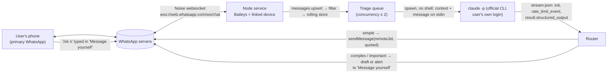

# WhatsApp → Claude assistant: research synthesis

As of **2026-09-26**. This synthesizes four research tracks (whatsapp-web.js, Baileys, Claude Code headless, terms/risk). Each track was checked by a skeptic. Refuted claims are dropped or corrected here. Claims nobody could verify are marked **UNVERIFIED**. The synthesizer re-ran the locked `claude -p` command 4 times and re-fetched one Meta page; those are marked *(synth)*.

Each claim is tagged with how it was verified: **[ran]** ran it on this machine · **[doc]** official doc · **[src]** read the source code · **[gh]** GitHub issue/PR · **[2nd]** secondary source. Section 12 lists every source with its URL and date.

Hard limit of the research: **no WhatsApp account was linked or paired**. Every WhatsApp experiment stopped at the point the QR payload was produced. Anything after pairing is sourced from code, docs or issues, not from a run.

---

## 1. Verdict

- **Technically plausible. The one untested step is also the one that decides it.** The Claude half works end to end on this machine. The locked `claude -p` command returned schema-valid triage JSON in 4.5–7.8 s wall-clock, and all 4 test messages (injection, tag-breakout, complex order, spam) landed in the correct category *(synth, [ran])*. On the WhatsApp half, Baileys reaches a QR in about 1 s at about 115–135 MiB RSS [ran]. Whether a new device can actually **link** on Baileys 7.0.0-rc14 is unproven: pairing has been reported broken since 2026-07-28 (#2737 [gh]). One manual pairing, done by the user, is the go/no-go test.
- **Both WhatsApp libraries are fragile and thinly maintained.** Baileys has had no maintainer commits, merges or comments since 2026-08-05 [gh]. whatsapp-web.js has merged nothing to main since 2026-07-27, and on today's WhatsApp Web its released version breaks reply/quote, getChats, fetchMessages and sendMessage return values [ran, src, gh]. Expect breakage every time WhatsApp ships an update, and plan for pinning and local patches.
- **Policy: the WhatsApp side violates the ToS. The Anthropic side is ambiguous.**
  - *WhatsApp:* its help center says linking an account to unofficial apps violates the Terms of Service and can get the account temporarily or permanently banned. The ToS also bars auto-messaging and "non-personal use" [doc]. No compliant configuration of this route exists. The whole account and its chat history are at stake.
  - *Anthropic:* spawning the official, unmodified `claude` binary under the user's own login is **not** OAuth-token reuse and **not** claude.ai scraping, both of which are prohibited [doc]. No official page, however, rules on whether an always-on bot fits "ordinary, individual usage" and the Consumer Terms' automated-access clause [doc]. An API key is the unambiguous route.
  - *Sanctioned alternative:* coexistence Cloud API on a WhatsApp Business app number (section 9).

---

## 2. How it works (data path)



1. **Link.** The user scans a QR once. Baileys stores the linked-device session in a local auth dir (mode 0700, outside git). No browser is involved [src, ran].
2. **Receive.** A message arrives as `messages.upsert` with `{messages, type}`. Live messages have type `'notify'`. Messages that queued while the service was offline arrive as `'append'`, so both types must be handled [src].
3. **Filter.** Drop, in this order: status (check it *before* broadcast, because `status@broadcast` matches both helpers), broadcast lists, newsletters, Meta AI (`@bot`), groups (v1), non-real messages (reactions, edits, revokes, ciphertext stubs), non-text, the bot's own echoes, and duplicate `key.id`s [ran, src].
4. **Context.** Baileys has no built-in message store in v7, so the service keeps its own rolling per-chat store. It is filled from `messages.upsert` and `messaging-history.set`, and the last N messages are sent as context [doc, src].
5. **Triage.** The service spawns `claude -p` with the isolation flags in section 7. The escaped message plus context goes in on **stdin**. The service reads the `init` event (to assert isolation), the `rate_limit_event` (quota) and `result.structured_output`, which has the shape `{category, confidence, reply, reason}` [ran].
6. **Route.** These thresholds are prototype defaults, not research findings.
   - **simple** with confidence ≥ 0.85, and quota utilization below the stop threshold → auto-send a quoted reply. The first auto-reply in each chat session carries an AI disclosure (Anthropic AUP, section 8).
   - **complex** → post `[DRAFT n]` to "Message yourself" and wait for `/ok n`, `/edit n <text>` or `/no n`.
   - **important** → post `[URGENT n]` plus a draft to "Message yourself".
   - **ignore** → do nothing, and do not mark the message read.
7. **Loop and duplicate guards.**
   - Keep the key ids of every message the bot sends; the bot's own sends echo back as `'append'` with `fromMe` set.
   - In self-chat, act only on messages that start with a command prefix.
   - Never auto-reply when `fromMe` is true.
   - A `fromMe` `'notify'` in a customer chat means the user answered from the phone, so cancel that chat's pending draft [src].

---

## 3. What works (verified)

| # | Claim | How |
|---|---|---|
| 1 | Baileys rc14 installs cleanly on Node 22.15 (72 packages, 59 MB) and reaches a QR in 0.88–1.05 s after the script starts. The skeptic's re-run took 0.98 s. No browser is needed. | [ran] |
| 2 | Baileys offline helpers work as documented: `normalizeMessageContent` unwraps ephemeral, viewOnce and documentWithCaption; `getContentType` skips `senderKeyDistributionMessage`; `isRealMessage` drops reactions, protocolMessage and CIPHERTEXT; JID helpers (`isJidGroup`, `isJidStatusBroadcast`, `isJidNewsletter`, `isJidMetaAI`, `jidNormalizedUser`, `areJidsSameUser`, `getKeyAuthor`) behave as expected. | [ran] |
| 3 | Baileys `sendMessage(jid, {text}, {quoted: m})` returns the sent `WAMessage`, so `sent.key.id` is available for loop-guarding. | [doc, src] |
| 4 | whatsapp-web.js 1.34.7 reaches a QR in 7.1–13.7 s (median 7.2 s) using system Chrome 138. `destroy()` tears down every Chrome process. | [ran] |
| 5 | whatsapp-web.js still exposes structured message fields (from, to, author, body, type, timestamp, fromMe). Wid ids still carry `_serialized` on WhatsApp Web 2.3000.1048557256. | [ran, src] |
| 6 | `claude -p` works from a clean `env -i` environment using the subscription login (`apiKeySource: "none"`), with no API key. | [ran] |
| 7 | The full isolation flag set loads 0 of 4 canaries (CLAUDE.md, auto memory, SessionStart hook, UserPromptSubmit hook), for about 449 input tokens of overhead. | [ran] |
| 8 | `--json-schema` returns a parsed object in `structured_output` and validates it, re-prompting on failure. `StructuredOutput` is the only tool, even with `--tools ""`. | [ran, doc] |
| 9 | `MAX_THINKING_TOKENS=0` on haiku gives 0 thinking tokens (4/4 runs), which settles that open question. | *(synth)* [ran] |
| 10 | Two concurrent `claude -p` processes on the same account both succeed. | [ran] |
| 11 | Every triage run on the test fixtures returned the expected category. Researcher: the "ignore previous instructions" injection → simple in 7/7 runs, and a payment complaint → important on both haiku and sonnet. Synth: 4/4 (injection → simple, escaped `</message><system>` tag-breakout → important, bulk custom order → complex, prize-scam spam → ignore). The sample is small. | [ran] |
| 12 | `--output-format stream-json --verbose` emits a `rate_limit_event` carrying five_hour and seven_day `utilization` and `resetsAt`. At synth time the values were 0.42 and 0.24, shared with the user's interactive sessions. | [ran] |

---

## 4. What doesn't work / limits

**Baileys 7.0.0-rc14**
- **Linking a new device is reportedly broken since 2026-07-28** (#2737, open) [gh, src].
  - Cause: the server sends `companion_reg_refresh` after the scan. rc14 has no handler for it (0 grep hits), and it reads `advSecretKey` only once when it builds the QR [src].
  - Fix: PR #2765, unmerged, with no maintainer review. Only **one** independent report says rc14 + #2765 pairs; another needed #2608 + #2749 + #2765 together [gh].
  - The pairing-code path may also be broken (#2832, rc13) [gh].
  - UNVERIFIED whether the default `Mac OS/Chrome` preset is affected; the #2737 trace used `Mac OS/Desktop`.
- **No maintainer activity** (no MEMBER/OWNER merges or comments) since 2026-08-05. There has been no npm release since 2026-07-29. The WhatsApp Web version bump (#2825) is unmerged [gh].
- **`markOnlineOnConnect` defaults to `true`**, and while the client shows as online the phone stops getting push notifications. It must be set to `false` explicitly. `syncFullHistory` also defaults to `true` [src, doc].
- **Full history sync looks unavailable on rc14.** The `Desktop` sub-platform is the only route to it. WIN32 gets a 428 close (fixed on master only), and #2741's own test matrix reports that DARWIN also gets a 428 [gh, src].
- **Other open issues:**
  - No built-in store (you write your own).
  - Messages to Meta AI look like self-chat and are redelivered every ~7 min (#2822).
  - Contacts who set a username arrive as `@lid` with no PN alt (#2742).
  - Quoted replies to media do not render on mobile (#2739).
  - The initial event buffer can hang, so `messages.upsert` never fires even though the connection shows open (#2810).
  - `useMultiFileAuthState` writes are not atomic.
  - v8 will need an auth-state migration [gh, doc].

**whatsapp-web.js 1.34.7** (the released version, against WhatsApp Web 2.3000.1043xxx and later)
- **The message key's `_serialized` is now the minified `$1`** [ran, gh]. As a result:
  - `msg.reply()`, `getQuotedMessage()`, `react()` and `downloadMedia()` break [src].
  - `getChats()` / `getChatById()` throw `r: r` [gh].
  - `sendMessage()` resolves to `undefined` even though the message is delivered [gh].
- **`fetchMessages()` (`t: t`) and `sendStateTyping()` (`r: r`) fail.** It is UNVERIFIED that the `$1` rename causes these failures or that `$1` patches fix them: one reporter replaced `_serialized` with `$1` and "still nothing works" [gh, src].
- **Media send has been broken since at least 2026-09-17** (#201922). A collaborator approved fix #201923 on 2026-09-25 [gh].
- **Sessions:** `authenticated` fires but `ready` never does (#201919, 2026-09-16; commenters needed local Store patches). Sessions log out every 30–60 min (#201865; one commenter, not the original poster, traced it to an undersized VM) [gh].
- **Footprint and security:** Chrome is required. Peak RSS is about 1.2 GB summed, or 0.49–0.52 GB PSS. `npm audit` reports 5 high-severity findings, all from `extract-zip` via `@puppeteer/browsers` [ran].

**`claude -p` (v2.1.283)**
- `--bare` refuses the subscription login ("Not logged in · Please run /login") [ran]. The docs say `--bare` "will become the default for `-p` in a future release" [doc], so a CLI auto-update could break the pipeline. Four versions were installed between 2026-09-22 and 09-26 (2.1.280 → 2.1.283) [ran].
- Errors come back as `is_error: true` with `subtype: "success"`. After structured-output retries run out, the `result` key is **absent**, not null [ran].
- The untrusted message cannot go in argv. Text starting with `-` is parsed as a flag (`"--version"` printed the version), and argv is visible in `ps` [ran].
- Plain `--output-format json` carries no rate-limit information; only stream-json does [ran].
- What `-p` returns when the subscription limit is exhausted has not been observed [doc: limit message text only].

**Environment**
- Linked devices log out if the phone goes unused for more than 14 days. There is a limit of 4 linked devices [doc].

---

## 5. Risks and mitigations

| Risk | Sev | Evidence | Mitigation in the prototype |
|---|---|---|---|
| Account ban or restriction of the user's own number. A restriction blocks linked devices and new chats. A ban blocks chat history and backups, and some bans are final. | **high** | Help center: linking unofficial apps "violates our Terms of Service" and may lead to a temporary or permanent ban. ToS (e) auto-messaging and (f) non-personal use. WhatsApp states it takes legal action. GitHub ban reports 2021–2026 are anecdotal, with no base rate [doc, gh]. | No ToS-compliant mitigation exists. The user accepts whole-account risk explicitly. Keep volume low, reply only inside chats the contact started, default to human approval, never message new contacts. Treat no setting as protection. |
| Baileys pairing never completes (#2737). | **high** | Open since 2026-07-30; fix #2765 unmerged [gh, src]. | Go/no-go gate: the user does one manual pairing on rc14. If it fails, pin a git build containing #2765 by commit SHA (review the diff first). If that fails, switch to whatsapp-web.js (section 6). |
| Reply loops, double-sends, false self-chat triggers. | **high** | Own sends echo back as `append`/fromMe. User typing in self-chat arrives as `notify`/fromMe. Meta AI traffic mimics self-chat (#2822) [src, gh]. | Keep a `sentByBot` set of key ids. Dedupe by `key.id`. Act in self-chat only on a command prefix. Never auto-reply on fromMe. `shouldIgnoreJid` includes `isJidMetaAI`. |
| Argv flag injection or data exposure through `claude`. | **high** | `claude -p "--version"` ran as a flag [ran]. | Put the message on stdin only. Use `spawn` with an args array and no shell. Only the trusted schema goes in argv. |
| Upstream breakage when WhatsApp ships an update (stale version → 405; protocol changes). | med | #2733 (405 `client_too_old`) was fixed only by a same-day release; no one is releasing now [gh]. | Pin the exact version. On a 405 or repeated 408, stop and alert instead of looping. Watchdog: if `receivedPendingNotifications` never arrives, recreate the socket. |
| Phone notifications suppressed, or escalations missed. | med | Default `markOnlineOnConnect: true` [doc]. `readMessages` sends blue ticks [src]. Whether self-chat messages from a linked device notify the phone is UNVERIFIED. | `markOnlineOnConnect: false`. Never mark drafted or escalated chats read. Test escalation notifications right after pairing. |
| Offline backlog silently dropped. | med | Backlog arrives as `append` [src]. | Process `append` messages that are not fromMe, are real, and have `messageTimestamp` > the persisted `lastProcessedTs`. |
| Shared Claude quota: the bot and the user's own Claude work share the 5-hour and weekly windows. | med | Utilization 0.42 / 0.24 during tests; limits unpublished [ran, doc]. | Haiku with thinking off (~$0.002–0.004 list-price estimate per call). Stop auto-replying and queue for the human above a utilization threshold or on `status != "allowed"`. |
| Anthropic policy: an always-on bot on a consumer plan. | med | Consumer Terms automated-means clause; "ordinary, individual usage"; "products or services … should use API key" [doc]. | Official unmodified binary, own login, own messages, low volume. Never touch tokens. Keep the backend behind one function so an API key can replace it. Ask Anthropic support for a definitive answer. |
| Billing change for `-p`. | med | Moving it to a separate credit was paused on 2026-06-15, not cancelled [doc]. | The same backend-swap seam. Re-check support article 15036540. |
| `--bare` becomes the `-p` default and breaks OAuth. | med | headless doc [doc]. | Assert `init.claude_code_version` and alert on "Not logged in". Set `DISABLE_AUTOUPDATER=1` in the child env (this does not stop the user's interactive sessions from updating the shared binary). |
| Prompt injection steers a reply to auto-send. | med | 11/11 resisted, small sample [ran]. | `--tools ""` means no actions are possible. Output is schema-constrained. Escape `&` and `<` before wrapping in `<message>`. Auto-send only for `simple` with confidence ≥ the threshold. Keep a human path. |
| Undisclosed AI replies to customers. | med | Anthropic AUP: external-facing interactive AI agents "must disclose … at a minimum at the beginning of each chat session" [doc]. | Add a disclosure line to the first auto-reply in each chat session. |
| Customer data sent to a consumer-plan AI (UU PDP). | med | Consumer data is used for training when that setting is on (5-year retention, otherwise 30 days) [doc]. The PDP household exemption does not cover customer service [doc]. | Turn off the training setting. Mask phone numbers and send only the minimum text. API/Commercial terms are the cleaner route. |
| Auth dir theft means someone can impersonate the account. | med | Baileys SECURITY.md: the auth dir is a long-lived credential; "Don't paste auth state into AI tools" [doc]. | Keep it at mode 0700 outside git. Never give auth files or debug logs to `claude`. |
| Session loss: 401 loggedOut, 14-day phone inactivity. | low | [doc, src] | Alert and stop on 401. Re-pairing is a manual user step. |

---

## 6. Library comparison and decision

| | **Baileys** `baileys@7.0.0-rc14` | **whatsapp-web.js** `1.34.7` |
|---|---|---|
| Latest release | 2026-07-29 (RC; npm `latest` points to it) [ran] | 2026-04-24 [ran] |
| Upstream activity | Last master commit 2026-08-04. No MEMBER/OWNER merges or comments since 2026-08-05 [gh] | Last main commit 2026-07-27. A collaborator approved media fix #201923 on 2026-09-25 [gh] |
| Transport | Direct Noise websocket plus libsignal and a Rust/WASM bridge; no browser [src] | Puppeteer drives headless Chrome on web.whatsapp.com and calls WhatsApp Web's internal `window.require('WAWeb*')` modules [src] |
| npm install | 9.3 s, 72 packages, 59 MB (sharp 28 MB) [ran] | 58.6 s (UNVERIFIED re-run), 193 packages, 86 MB, plus a 626 MB browser download unless `PUPPETEER_SKIP_DOWNLOAD` is set (UNVERIFIED re-run) [ran] |
| Time to QR | 878 / 934 / 959 / 1047 ms from script start; 1172–1245 ms from process start; skeptic re-run 981 ms [ran] | 7178 / 13729 / 7124 ms [ran] |
| Peak memory at QR | 114–133 MiB RSS (single process) [ran] | 1.20–1.22 GB summed RSS; PSS 0.49–0.52 GB; the node process alone 77–97 MB [ran] |
| Processes | 1 (node) | node plus about 11 Chrome processes (the reported "13" counted `sh` and `ps`; corrected) [ran] |
| Pairing | **Reportedly broken since 2026-07-28** (#2737); fix unmerged [gh] | Done by WhatsApp Web's own code; not tested. #201919 reports `ready` never firing after auth [gh] |
| Receive text | `messages.upsert`, both `notify` and `append` [src] | `'message'` (not fromMe) / `'message_create'` (all) [src] |
| Recent context | Own store, plus `sock.fetchMessageHistory(n, oldestKey, oldestTs)` on demand (phone must be online) [doc, src] | `chat.fetchMessages()` is **broken** (`t: t`), and the fix is unverified [gh] |
| Self-chat detection | `sock.user.id` (PN) and `sock.user.lid`, compared with `areJidsSameUser` [src] | `client.info.wid` plus `getContactLidAndPhone`; `'message'` never fires for self-chat [src, gh] |
| Send / quote | `sendMessage(jid,{text},{quoted:m})` returns the key [doc] | `reply()` broken; `sendMessage` returns `undefined`; needs local patches that are untested live [gh] |
| Skip groups/status | `isJidGroup`, `isJidStatusBroadcast`, `isJidBroadcast`, `isJidNewsletter`, `isJidMetaAI` [ran] | Suffix checks plus `msg.isStatus` [src] |
| Coupling to WhatsApp internals | Wire protocol; breaks on protocol or version changes | WhatsApp Web's minified modules; broke on the `$1` rename [ran] |

**Decision: Baileys** (`baileys`, pinned exactly to `7.0.0-rc14`, ESM, Node 22).

After pairing, it covers all five needs without patches: receive text, recent context via its own store, self-chat detection, send/quote with a returned id, and skipping groups/status. It needs no browser, starts 7× faster, uses about 4–9× less memory, and does not depend on WhatsApp Web's minified internals, which is exactly what broke whatsapp-web.js.

Its weakness is concentrated in one step, pairing, and the user can test that step before any build work. whatsapp-web.js's breakage is spread across the core paths (reply, getChat, fetchMessages, the sendMessage return value), and its patches are untested live.

**Switch to whatsapp-web.js if any of these happen:**
1. The user's one manual pairing fails on rc14 **and** on rc14 + #2765 pinned by commit SHA.
2. After pairing, `messages.upsert` stops firing (#2810) repeatedly, or 405/408 loops persist with no upstream release.
3. whatsapp-web.js ships a release that merges the `$1`/MsgKey fix (#201901 / #201840) and the `#201919` ready-hang is closed.

Baileys v8 (a new auth format with a forced migration) is **not** a switch trigger. Keep rc14 pinned for the life of the prototype.

---

## 7. Claude Code headless findings

### 7.1 Locked command (verified 4/4 *(synth)*, `claude` 2.1.283, 2026-09-26)

```bash
cd "$EMPTY_DIR" && env -i HOME="$HOME" PATH="$PATH" LANG=C.UTF-8 \
  CLAUDE_CODE_DISABLE_AUTO_MEMORY=1 MAX_THINKING_TOKENS=0 ENABLE_CLAUDEAI_MCP_SERVERS=false \
  DISABLE_AUTOUPDATER=1 MAX_STRUCTURED_OUTPUT_RETRIES=2 \
  claude -p --model haiku \
    --output-format stream-json --verbose \
    --safe-mode --setting-sources "" --strict-mcp-config \
    --tools "" --disallowedTools "mcp__*" --disable-slash-commands --no-session-persistence \
    --system-prompt-file "$PROMPT_DIR/triage-system.txt" \
    --json-schema "$(cat "$PROMPT_DIR/triage-schema.json")" \
  < message.txt
```

- **From Node:** call `spawn('claude', args, {cwd: EMPTY_DIR, env: {...}, stdio: ['pipe','pipe','pipe']})` with no shell, then `child.stdin.end(wrapped)`. Kill the child with SIGTERM after 60 s; that gives exit 143 and no result.
- **Wrapping:** `<message from="…" name="…">\n${text}\n</message>`. Escape `&` → `&amp;` and `<` → `&lt;` in the text and in the attributes. Context messages use the same escaping.
- **Schema:**
  ```json
  {"type":"object","properties":{"category":{"type":"string","enum":["simple","complex","important","ignore"]},"confidence":{"type":"number","minimum":0,"maximum":1},"reply":{"type":"string"},"reason":{"type":"string"}},"required":["category","confidence","reply","reason"],"additionalProperties":false}
  ```
- **Success test:** exit code 0 **and** `result.is_error === false` **and** `result.structured_output` is present. Do not branch on `subtype` or `stop_reason`; `stop_reason` is `tool_use` on success.
- **Startup assertions on the `system/init` line:**
  - `tools` is `["StructuredOutput"]`
  - `mcp_servers`, `skills` and `slash_commands` are `[]`
  - `apiKeySource` is `"none"`
  - `claude_code_version` is logged
  - `model` is logged (it was `claude-haiku-4-5-20251001`)
- **Quota line:** `rate_limit_event.rate_limit_info` → `status` (`allowed` / `allowed_warning` / `rejected`), `unifiedWindows.five_hour.utilization`, `unifiedWindows.seven_day.utilization`, `resetsAt` (unix seconds).
- **Inputs used for the verification runs:**
  - Files: `~/copilot/research/wa-claude-assistant/synth-claude/` (`run-locked.sh`, `triage-system.txt`, `triage-schema.json`, `v1..v4*.txt`, `out/`).
  - `ENABLE_CLAUDEAI_MCP_SERVERS=false` (env var) and `--disallowedTools "mcp__*"` (flag) are documented [doc]. Both were in the verified runs, but neither was tested on its own.

### 7.2 Isolation / leak test

The canary directory contained a project CLAUDE.md, auto-memory MEMORY.md, and SessionStart and UserPromptSubmit hooks.

| Run | Flags | Canaries leaked | Input tokens | How |
|---|---|---|---|---|
| A | defaults | 4/4; both hooks fired; claude.ai connector connected | 22,351 | [ran] |
| B | `--setting-sources "" --strict-mcp-config --tools "" --system-prompt … --no-session-persistence --disable-slash-commands` | 1/4 (auto memory) | 574 | [ran] |
| C | B + `--safe-mode` | 0/4; `[claudeai-mcp] Disabled in safe mode` | 449 | [ran] |
| M2 | B + `CLAUDE_CODE_DISABLE_AUTO_MEMORY=1` | 0 | 449 | [ran] (skeptic) |
| M3 | B + `--restricted` | 0 (connector list fetched, not connected) | 449 | [ran] (skeptic) |
| V1–V4 | the locked command | init: tools `[StructuredOutput]`, mcp/skills/slash `[]`, apiKeySource `none` | 1,259–1,303 (triage prompt plus message) | *(synth)* [ran] |

- The built-in plugins `agents-md@builtin` and `telemetry@builtin` still load under `--safe-mode` [ran].
- The documented control for auto memory is the env var, so the lock uses the env var **and** `--safe-mode`, which is documented as a troubleshooting flag [doc].
- The model's self-report of "39 tools / 21 skills" in run A was unreliable and has been dropped. The log shows 8 loaded skills [ran].

### 7.3 Latency (wall = spawn → exit; `duration_ms` = CLI-reported)

| Config | Wall ms | duration_ms | Fixed overhead ms | Source |
|---|---|---|---|---|
| **Locked cmd, haiku, thinking off, stdin** | 7258 / 7677 / 7826 / 4519 | 5056 / 5468 / 5748 / 2123 | 2202 / 2209 / 2078 / 2396 | *(synth)* [ran] |
| haiku, thinking off, 2 concurrent | 8641 / 7308 | 5773 / 4557 | 2868 / 2751 | [ran] |
| haiku, thinking on, stdin | 10978 | 8713 | 2265 | [ran] |
| sonnet 5, thinking off, stdin | 11421 | 6354 | 5067 (loaded machine) | [ran] |
| sonnet 5, thinking on (3 s stdin wait removed) | 10232 / 9941 / 13683 | 7720 / 7748 / 11246 | 2193–2512 | [ran] |

- Fixed per-spawn overhead is about 1.7–2.9 s [ran]. It breaks down as `system/init` at 1.7–2.3 s after spawn, and exit 0.6–1.0 s after the result line [ran].
- The sample is n = 1–4 per configuration, which gives no usable p95.
- With default thinking on, haiku is **not** faster than sonnet 5 [ran].
- Estimated end-to-end time from an incoming WhatsApp message to an auto-reply is about 5–10 s. Only the Claude part was measured; the WhatsApp receive and send legs are unmeasured.

### 7.4 Cost / quota

- The `total_cost_usd` list-price estimate for the locked command is $0.0020–0.0036 per call [ran]. It is a client-side estimate, and for Pro/Max it "isn't relevant for billing purposes" [doc].
- Real consumption comes out of the shared 5-hour and weekly subscription windows. Anthropic publishes their structure but not their size [doc].
- This account is `subscriptionType: max`; whether that is 5x or 20x is unknown [ran].
- An `ANTHROPIC_API_KEY` in the environment silently switches `-p` to API billing ("always used when present") [doc]. `env -i` prevents that.

### 7.5 Caveats

1. The `--bare` default change will break OAuth `-p`. The CLI auto-updates almost daily, and 4 versions are kept under `~/.local/share/claude/versions/`.
2. `--safe-mode` is a troubleshooting flag and its scope may change. The init assertions catch any regression.
3. Success means exit code plus `is_error`. `result` is absent on `error_max_structured_output_retries`. `MAX_STRUCTURED_OUTPUT_RETRIES` counts total attempts.
4. An invalid schema fails before any API call, with exit 1, empty stdout and an error on stderr. The `format` keyword is not enforced.
5. Model aliases float; `haiku` resolved to `claude-haiku-4-5-20251001` on 2026-09-26.
6. Stdin is capped at 10 MB [doc]. An argv prompt with an open, empty stdin adds a 3 s wait [ran]. The `--` end-of-options separator is an alternative, but stdin is locked.
7. Drafts can over-promise. The V3 `complex` draft promised a follow-up the owner never agreed to *(synth)*. This is why `complex` must stay a draft.

---

## 8. Policy notes

### WhatsApp (Indonesia is under WhatsApp LLC and the consumer ToS effective 2021-01-04) [doc]
- **ToS "Legal and Acceptable Use":** (e) prohibits "bulk messaging, auto-messaging, auto-dialing, and the like"; (f) prohibits "any non-personal use of our Services unless otherwise authorized by us". Auto-replying to customers from a personal account plausibly hits both, whatever client is used.
- **ToS "Harm to WhatsApp":** prohibits, "directly or through automated means", reverse engineering or modifying the Services, and "collect[ing] information … in any impermissible or unauthorized manner".
- **Help center on unofficial apps:**
  - faq 1217634902127718: linking to unofficial versions "violates our Terms of Service" and can lead to temporary or permanent bans or restrictions, "including the ability to link devices".
  - faq 1064395290901991: "Using an unauthorized application and/or unsupported device violates our Terms of Service".
  - faq 378279804439436: linking to an unofficial app or website "now or in the past, may result in a temporary or permanent account ban".
- **Consequences:**
  - A temporary ban can escalate to a permanent one (faq 1848531392146538).
  - While banned, the user cannot reach chat history or backups. Where no review option appears, the ban "is final and can't be appealed" (faq 465883178708358, 723378546580115).
  - WhatsApp says it takes legal action against automated or bulk messaging and non-personal use, even on off-platform evidence, and bans accounts using machine-learning classifiers (faq 5957850900902049).
- **Business App Terms (effective 2026-09-23):** Restriction (g) prohibits "develop or use any applications that interact with our Business App Services without our prior written consent". Moving to the Business app therefore does **not** legitimize an unofficial client. It is UNVERIFIED whether (g) is new in this revision.
- **Evidence quality:** the GitHub ban reports are anecdotal and self-selected, and many involve bulk or outbound sending. There is no base rate.

### Anthropic: our design compared with the prohibited categories

| Category | What it is | Status | Source |
|---|---|---|---|
| **(1) Our design** | A local Node service spawns the **official, unmodified `claude` binary**. The CLI handles its own login. Our code never reads tokens, credentials or `~/.claude` files, and never calls claude.ai endpoints. The data is the user's own messages. | **Not explicitly permitted or prohibited for a 24/7 bot.** For: the restriction does not "prevent an end user from signing in to the unmodified Claude Code binary with their own Claude subscription"; `-p` is documented "for scripts and CI/CD"; `setup-token` is documented "for CI pipelines, scripts". Against: the Consumer Terms bar access "through automated or non-human means, whether through a bot, script, or otherwise" except via an API key "or where we otherwise explicitly permit it"; limits "assume ordinary, individual usage"; "Developers building products or services … should use API key authentication". | [doc] legal-and-compliance, headless, authentication, consumer-terms |
| (2) OAuth reuse | A third-party app offers claude.ai login, routes requests through Pro/Max credentials, or collects or intermediates tokens | **Prohibited**: "developers may not collect, store, or intermediate Claude.ai credentials or session tokens" | [doc] legal-and-compliance, agent-sdk/overview |
| (3) Scraping claude.ai | Driving the web app or its private endpoints | **Prohibited**: Consumer Terms "crawl, scrape, or otherwise harvest", plus the automated-means clause | [doc] consumer-terms |

- **Unambiguous route:** an Anthropic API key under the Commercial Terms, which is expressly carved out of the automation clause. It needs no binary change: add `ANTHROPIC_API_KEY` to the child env. `--bare` then works too, because it accepts an API key [doc].
- **Billing:** `claude -p` still draws from subscription limits. The move to a separate credit (Pro $20, Max 5x $100, Max 20x $200 at API rates) was **paused on 2026-06-15**, not cancelled [doc].
- **AUP (effective 2025-09-15), which applies to our replies:**
  - It bars presenting results "as human-generated" to convince someone they are talking to a person.
  - "All consumer-facing chatbots, including any external-facing or interactive AI agent, must disclose to users that they are interacting with AI rather than a human … at a minimum at the beginning of each chat session" [doc]. The prototype must disclose.
- **Consumer Terms on inputs:** the user "represent[s] and warrant[s]" having the permissions needed for Anthropic to process the inputs, which here are third parties' messages [doc].
- **Data:** consumer accounts are used for training when the setting is on, with 5-year retention (otherwise 30 days). Anthropic PBC acts as controller [doc].

### Indonesia (from the risk track; primary PDFs, not re-checked by the skeptic)
- **UU 27/2022 (PDP):**
  - Pasal 2(2) exempts only "kegiatan pribadi atau rumah tangga"; customer service is outside that exemption.
  - Pasal 20 sets the lawful bases.
  - Pasal 51 makes the controller responsible for its processors.
  - Pasal 56 governs cross-border transfer: equal or higher protection, adequate and binding protection, or consent.
  - Pasal 57 sets administrative fines of up to 2% of annual revenue.
  - [doc]
- **PP 33/2026:** the implementing regulation. Press reports differing effective dates (15 or 16 Jan 2027) [2nd, UNVERIFIED].
- **SE Kominfo 9/2023:** AI-ethics transparency guidance that is not binding [doc].

---

## 9. Official alternatives

| Option | Works on the personal (Messenger) number? | Claude writes replies? | Ban / ToS risk | Cost / setup |
|---|---|---|---|---|
| **Unofficial linked device (this prototype)** | Yes, technically | Yes | **High**: ToS violation per help center | Free; always-on host; phone used within every 14 days |
| **Business app + coexistence Cloud API** (Embedded Signup, `featureType: whatsapp_business_app_onboarding`) | Only after moving the number to the WhatsApp Business app; this is supported and keeps history [doc] | Yes. Service replies "can be powered by … a 3rd-party AI solution" *(synth re-fetch, [doc])*. Automation must offer escalation paths. §4.7 bars general-purpose assistants as the primary function | Low, if the policy is followed: opt-in, 24 h window, templates outside it | Requires a Solution Partner or Tech Provider (or a BSP). From 2026-10-01: a free tier of 1,000 service messages per number per month, then USD 0.025 / IDR 356.65 each in Indonesia. Replies typed in the Business app stay free. 20 mps. No groups. Linked devices are unlinked at onboarding [doc] |
| **Cloud API on a dedicated new number** | No: a number in use with Messenger "cannot be registered unless [it is] deleted first" [doc] | Yes, same as above | Low | Same as above, plus a new number |
| **Business app native tools** (greeting, away, 50 quick replies, 20 labels) | After moving to the Business app | No: canned text only | None | Free |
| **Meta Business Agent** | After moving to the Business app | No: this is Meta's AI. Meta collects the chats "to improve AI at Meta". It disables greeting and away messages and unlinks linked devices [doc] | Low | Free to start, subscription later [doc]. "Limited countries". Indonesia availability comes from press only [2nd, UNVERIFIED] |
| **Anthropic API key** instead of `claude -p` on a subscription | n/a | Same CLI, same flags; `--bare` becomes usable | Removes the Anthropic ambiguity; Commercial Terms give no training by default and 30-day retention [doc] | Pay per token (about $0.002–0.004 per triage at list price, [ran] estimate) |

The two Meta pricing pages conflict on what happens without a payment method. The non-template doc (updated 2026-08-25) says delivery stops from 2026-10-01 if no payment method is on file by 2026-09-30. The newer pricing doc (updated 2026-09-10) says Meta "will deliver service messages within the shared free tier" and stops only after the free tier is used [doc].

---

## 10. Open questions

1. **Pairing (go/no-go):** does QR linking complete on unpatched rc14 with the default `Mac OS/Chrome` preset? If not, does it complete with #2765? Only a real, user-performed pairing can answer this.
2. **Self-chat id form:** in "Message yourself" under LID addressing, is `key.remoteJid` the user's own PN or own LID? Does `sendMessage(jidNormalizedUser(sock.user.id))` land in the same chat?
3. **Escalation notifications:** does a message a linked device posts to self-chat trigger a push notification on the phone? It is `fromMe`, so possibly not; if it doesn't, escalations are silent.
4. **Read state:** does `readMessages()` from the linked device clear the unread badge on the phone?
5. **Quota exhaustion:** what exact `-p` JSON and exit code come back when the subscription limit is exhausted? What share of the 5-hour window does one triage call use? (Diff utilization across about 50 idle calls.)
6. **Anthropic policy:** does Anthropic consider an always-on personal WhatsApp auto-responder "ordinary, individual usage"? Ask support, or use an API key.
7. **Session model:** does a long-lived `--input-format stream-json` process remove the ~2 s per-call spawn cost while keeping per-message isolation? Untested.
8. **Upstream timing:** will Baileys merge #2765 / #2825 and cut rc15 before v8's auth-format change? Will whatsapp-web.js merge the `$1` fix?
9. **Username contacts:** do contacts with WhatsApp usernames (`@lid` with no PN alt, #2742) reach `messages.upsert` at all?
10. **Resource use after pairing:** memory and CPU after pairing and initial sync are unmeasured for both libraries.

---

## 11. Artifacts left on disk (not deleted)

These were left for the builder and for re-checking greps. Delete them when done.

- `~/copilot/research/wa-claude-assistant/`:
  - `exp-baileys/` (59 MB: `probe.mjs` stops at QR and deletes auth; `helpers-check.mjs`; `node_modules`)
  - `exp-wwebjs/` (86 MB)
  - `claude-exp/` (3.5 MB)
  - `claude-skeptic/` (2.2 MB)
  - `synth-claude/` (verification runs)
  - `synth-meta/`
  - `terms-risk/` (14 MB; holds a duplicate UU 27/2022 PDF)
  - `risk-skeptic/`
  - `skeptic-baileys/` (11 MB; its earlier `rm` was permission-denied)
  - `claude-leaktest/.claude` (empty)
- `~/.claude/projects/-home-irvan-copilot-research-wa-claude-assistant-claude-leaktest/` (192 KB: the canary MEMORY.md and one session transcript; the earlier `rm` was permission-denied)
- Processes: none. The synth runs left no `claude -p` or playwright process, confirmed with `ps`, and created no session files.

---

## 12. Sources (all retrieved 2026-09-26 unless another date is given)

**WhatsApp libraries**
- https://registry.npmjs.org/whatsapp-web.js [ran]. Latest 1.34.7, published 2026-04-24.
- https://github.com/wwebjs/whatsapp-web.js/releases, /commits/main [ran]. Last main commit 2026-07-27.
- whatsapp-web.js issues [gh]:
  - https://github.com/wwebjs/whatsapp-web.js/issues/201830 (2026-07-15, the `$1` rename)
  - /issues/201845 and /201838 (getChats / getChatById)
  - /issues/201884 (2026-08-05, fetchMessages)
  - /issues/201868 (sendStateTyping)
  - /issues/201919 (2026-09-16, ready never fires)
  - /issues/201864, /201849, /201865, /201855
  - /issues/201922 (2026-09-17, media send)
  - /issues/2653 (message vs message_create)
- whatsapp-web.js PRs [gh]: https://github.com/wwebjs/whatsapp-web.js/pull/201901, /pull/201840, /pull/201910, /pull/201869, /pull/201871, /pull/201923 (approved 2026-09-25), /pull/201723, /pull/201835.
- https://github.com/wwebjs/whatsapp-web.js#disclaimer [src]
- https://wwebjs.dev/guide/creating-your-bot/authentication.html [doc]
- https://github.com/advisories/GHSA-jmr9-qjv8-65gv and https://github.com/advisories/GHSA-7pqw-9j4j-h8q3 [ran, npm audit]
- https://registry.npmjs.org/baileys and https://registry.npmjs.org/@whiskeysockets/baileys [ran]. Latest 7.0.0-rc14, published 2026-07-29.
- https://github.com/WhiskeySockets/Baileys/releases/tag/v7.0.0-rc10 (2026-05-06) and https://github.com/WhiskeySockets/Baileys/blob/master/SECURITY.md [doc]
- Baileys issues and PRs [gh]:
  - https://github.com/WhiskeySockets/Baileys/issues/2737 (2026-07-30)
  - /pull/2765 (2026-08-10 .. 09-23)
  - /pull/2741 (merged 2026-08-04)
  - /pull/2825 (2026-09-20)
  - /issues/2733 (2026-07-29)
  - /issues/2822 (2026-09-16)
  - /issues/2742, /issues/2739, /issues/2810 (2026-09-08), /issues/2797, /issues/2800, /issues/2805 (2026-09-07), /issues/2832 (2026-09-25), /issues/2777
- Baileys docs [doc]:
  - https://baileys.wiki/faq
  - /migration/v7, /migration/v8
  - /concepts/events, /concepts/jids, /concepts/data-store, /concepts/socket-config
  - /advanced/troubleshooting, /advanced/history-sync
  - /features/presence
  - /authentication/session-management
  - /messaging/sending-messages, /messaging/message-actions

**Claude Code / Anthropic** [doc unless noted]
- Claude Code docs:
  - https://code.claude.com/docs/en/headless (`--bare` future default: line 62)
  - https://code.claude.com/docs/en/cli-reference
  - https://code.claude.com/docs/en/env-vars
  - https://code.claude.com/docs/en/memory
  - https://code.claude.com/docs/en/errors
  - https://code.claude.com/docs/en/authentication
  - https://code.claude.com/docs/en/legal-and-compliance
  - https://code.claude.com/docs/en/agent-sdk/overview
  - https://code.claude.com/docs/en/agent-sdk/typescript
  - https://code.claude.com/docs/en/costs
  - https://code.claude.com/docs/en/data-usage
- Anthropic legal:
  - https://www.anthropic.com/legal/consumer-terms (effective 2025-10-08)
  - https://www.anthropic.com/legal/aup (effective 2025-09-15; quotes re-grepped *(synth)*)
  - https://www.anthropic.com/legal/privacy (effective 2026-09-10)
  - https://www.anthropic.com/supported-countries
- Claude support articles:
  - https://support.claude.com/en/articles/15036540-use-the-claude-agent-sdk-with-your-claude-plan (update of 2026-06-15; page dated 2026-06-16)
  - https://support.claude.com/en/articles/8325606-what-is-the-pro-plan
  - https://support.claude.com/en/articles/11049741-what-is-the-max-plan
  - https://support.claude.com/en/articles/11145838-use-claude-code-with-your-pro-or-max-plan (updated 2026-08-19)
- Local runs [ran]: `~/copilot/research/wa-claude-assistant/claude-exp/out/*` (researcher), `claude-skeptic/out/*` (skeptic), `synth-claude/out/v1..v4*` (synth).

**WhatsApp / Meta policy** [doc]
- https://www.whatsapp.com/legal/terms-of-service (effective 2021-01-04)
- https://www.whatsapp.com/legal/WhatsApp-Terms-for-WhatsApp-Business-App (effective 2026-09-23)
- Help center, bans and unofficial apps:
  - https://faq.whatsapp.com/1217634902127718
  - https://faq.whatsapp.com/1064395290901991
  - https://faq.whatsapp.com/378279804439436
  - https://faq.whatsapp.com/1848531392146538
  - https://faq.whatsapp.com/465883178708358
  - https://faq.whatsapp.com/723378546580115
  - https://faq.whatsapp.com/717472490411581
  - https://faq.whatsapp.com/5957850900902049
  - https://faq.whatsapp.com/361005896189245
- Help center, Business app features:
  - https://faq.whatsapp.com/663543925287107
  - https://faq.whatsapp.com/501866148528310
  - https://faq.whatsapp.com/2565868990219715
  - https://faq.whatsapp.com/1791149784551042
  - https://faq.whatsapp.com/3398508707096369
- Help center, Meta Business Agent:
  - https://faq.whatsapp.com/1153795669452207
  - https://faq.whatsapp.com/291930066973116
  - https://faq.whatsapp.com/2112106596314330
- https://about.fb.com/news/2026/06/meta-business-agent/ (2026-06-03)
- Meta developer docs:
  - https://developers.facebook.com/documentation/business-messaging/whatsapp/embedded-signup/onboarding-business-app-users (updated 2026-06-26)
  - https://developers.facebook.com/documentation/business-messaging/whatsapp/changelog
  - https://developers.facebook.com/documentation/business-messaging/whatsapp/business-phone-numbers/phone-numbers (updated 2026-05-21)
  - https://developers.facebook.com/documentation/business-messaging/whatsapp/pricing (updated 2026-09-10; 1,000 free tier)
  - https://developers.facebook.com/documentation/business-messaging/whatsapp/pricing/non-template-messages (updated 2026-08-25; re-fetched *(synth)*)
  - https://developers.facebook.com/documentation/business-messaging/whatsapp/pricing/ai-providers
- Meta terms and policy:
  - https://www.facebook.com/legal/Meta-Terms-for-WhatsApp-Business-Platform (last modified 2026-09-23; §4.7)
  - https://business.whatsapp.com/policy → https://whatsappbusiness.com/id/policy/ (updated 2026-09-23)
- GitHub ban reports [gh, anecdotal]:
  - https://github.com/wwebjs/whatsapp-web.js/issues/981 (2021-11-20)
  - https://github.com/wwebjs/whatsapp-web.js/issues/2331 (2023-07-05)
  - https://github.com/wwebjs/whatsapp-web.js/issues/3894 (2025-10-12)
  - https://github.com/wwebjs/whatsapp-web.js/issues/4008 (2025-12-08)
  - https://github.com/WhiskeySockets/Baileys/issues/225 (2023-07-05)
  - https://github.com/WhiskeySockets/Baileys/issues/1869 (2025-10-05)
  - https://github.com/WhiskeySockets/Baileys/issues/2309 (2026-01-30)
  - https://github.com/WhiskeySockets/Baileys/issues/2707 (2026-07-14)
- Secondary [2nd]: https://www.fortuneidn.com/tech/whatsapp-perkuat-sektor-bisnis-dengan-agen-ai-00-4pj81-qxb2xn (2026-08-11)

**Indonesia**
- https://peraturan.bpk.go.id/Details/229798/uu-no-27-tahun-2022 (2022-10-17) [doc]
- https://jdih.komdigi.go.id/produk_hukum/view/id/883/t/surat+edaran+menteri+komunikasi+dan+informatika+nomor+9+tahun+2023 (2023-12-19) [doc]
- https://www.hukumonline.com/pusatdata/detail/lt6a9164bf1e96a/peraturan-pemerintah-nomor-33-tahun-2026/analysis/ (2026-07) [2nd]
- https://www.antaranews.com/berita/5377558/kemkomdigi-siapkan-aturan-konten-buatan-ai-wajib-diberi-label (2026-01-26) [2nd]

---

## Dated note 2026-09-28: ban likelihood, risk reduction, Cloud API pricing

Three read-only research tracks, each re-checked by a skeptic against primary pages (retrieved 2026-09-28).

**Ban likelihood (unofficial linked device):**
- No base rate exists for a low-volume, reply-only bot. WhatsApp publishes only totals ("over two million accounts per
  month for bulk or automated behavior — over 75% without a recent user report", 2019 white paper; monthly India
  reports of ~5 M bans, all causes). Operator self-reports ("out of 700 instances, I got two alerts", Baileys #2658)
  are unverifiable and self-selected.
- Help center: linking an unofficial app "now or in the past, may result in a temporary or permanent account ban"
  (faq.whatsapp.com/378279804439436, /1217634902127718, /1064395290901991). The ToS bans auto-messaging and non-personal
  use (whatsapp.com/legal/terms-of-service).
- WhatsApp's own advice matches a reply-only bot ("Only send messages to those who have contacted you first",
  faq.whatsapp.com/361005896189245), but reply-only and low-volume accounts were also restricted or banned in 2024–2026
  enforcement waves (e.g. Baileys #2800 on 2026-09-27: customers started every chat, the same reply went to ~100 users).
- Baileys rc14 emits `connection.update.reachoutTimeLock` when an account is restricted; this repo does not read it.

**Legitimate risk reducers:** reply only to people who wrote first (done per message); low volume (caps 3/chat/h,
30/day); no link or media spam (text only, `linkPreview: null`); honour stop requests (no customer-side stop keyword
yet); a separate number to contain the blast radius. Anti-detection tricks are out of scope (CLAUDE.md).

**WhatsApp Cloud API pricing, Indonesia** (developers.facebook.com/documentation/business-messaging/whatsapp/pricing,
"Updated Sep 10, 2026"):
- Per delivered message since 2025-07-01. Templates: marketing USD 0.0411 (IDR 586.33), utility and authentication
  USD 0.025 (IDR 356.65) since 2026-07-01.
- **Until 2026-09-30 replies inside the 24 h customer-service window are free. From 2026-10-01 they cost USD 0.025
  (IDR 356.65) each, after 1,000 free delivered service messages per business number per month** (no rollover). Owner
  notices and approved drafts sent from the business number count too. whatsappbusiness.com's pricing page still says
  service messages are free (stale as of 2026-09-28).
- Direct access needs no provider ("no additional fee to access our platform directly"), a number not in use on
  WhatsApp (delete it from the app first), a 2FA PIN, a display name, a valid-TLS HTTPS webhook and a payment method.
  Keeping the number on the WhatsApp Business app (coexistence) goes through a Solution Partner or Tech Provider;
  Indonesia is not named in Meta's coexistence country changelog entries.
- Business Messaging Policy (2026-09-23): automation needs "prompt, clear, and direct escalation paths", a business
  profile with support contact info and a published privacy policy. Meta Terms §4.7 bars providers whose primary
  function is a general-purpose AI assistant; customer-service replies are allowed.
